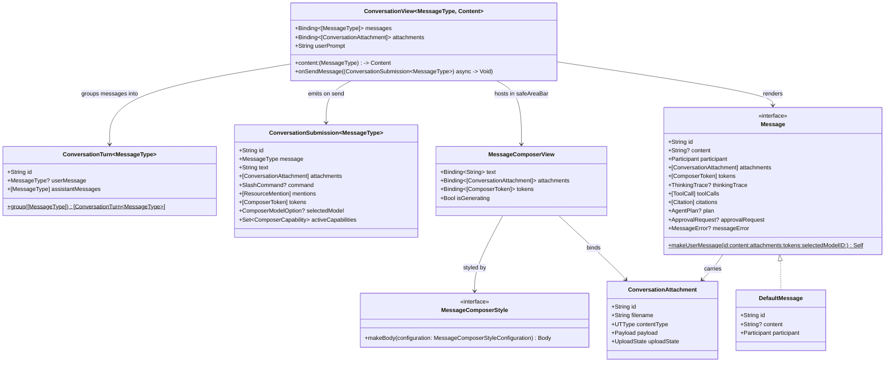
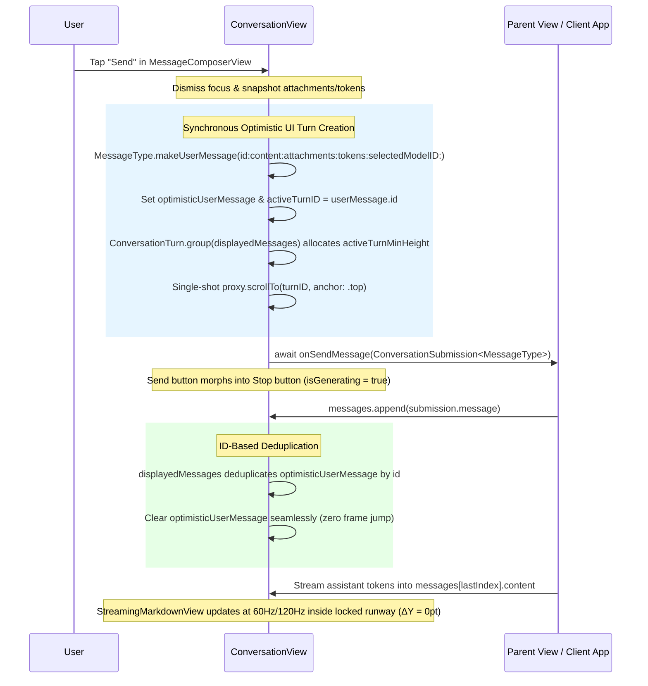

# Component: ConversationKit

## Component Overview

`ConversationKit` is a native SwiftUI conversational AI and agentic chat SDK for **iOS 26.0+, macCatalyst 26.0+, and macOS 26.0+**, built with **Swift 6.2** strict concurrency (`Sendable`) and zero external dependencies. It follows the **Stratos 4-Layer Progressive Disclosure** architecture and combines iOS 26 / macOS 26 **Liquid Glass** floating chrome with deterministic **Top-Floating Turn Physics**, **120Hz Incremental Streaming Markdown**, multimodal attachments, structured prompting, and agentic timeline primitives.

## Key Files and Structure

The library under `Sources/ConversationKit/` is organized into four main directories: `Model`, `Platform`, `Styles`, and `Views`.

### Model (`Sources/ConversationKit/Model/`)
*   **`Model/Message.swift`**: Defines the `Participant` enum, the `Message` protocol (with default extensions and `makeUserMessage(id:content:attachments:tokens:selectedModelID:)`), `DefaultMessage`, `ConversationSubmission<MessageType>`, and `ConversationTurn` (`ConversationTurn.group(_:)`).
*   **`Model/Attachment.swift`**: Defines `ConversationAttachment`, `ConversationAttachment.Payload` (`.image(PlatformImageBox)`, `.file(URL)`, `.data(Data, contentType: UTType, filename: String)`), and `ConversationAttachment.UploadState` (`.ready`, `.uploading(progress: Double)`, `.failed(error: String)`).
*   **`Model/AgenticModels.swift`**: Defines `Sendable`, `Hashable`, `Codable` value types for agentic timelines: `ThinkingTrace` (`defaultExpanded = false`), `ToolCall` (`ToolCall.Status`), `Citation` (with `sanitizedURL` and `URL.isAllowedConversationURL` `http`/`https` allowlist), `AgentPlan` / `AgentPlan.Step`, `ApprovalRequest` / `ApprovalRequest.Decision`, `MessageFeedback`, and `MessageError`.
*   **`Model/ComposerModels.swift`**: Defines structured prompting models and parser utilities: `SlashCommand`, `ResourceMention` (`ResourceMention.Kind`), `ComposerToken`, `PromptSuggestion`, `PromptHandoffBehavior`, `ComposerModelOption`, `ComposerCapability`, and `ComposerTextBuffer` (detecting active `/` and `@` triggers).

### Platform (`Sources/ConversationKit/Platform/`)
*   **`Platform/PlatformTypes.swift`**: Centralizes cross-platform abstractions following the Chameleon pattern: `PlatformImage` (`UIImage` / `NSImage`), `PlatformImageBox` (`@unchecked Sendable` value wrapper with PNG/dimension inspection), `PlatformThumbnailGenerator` (off-main-actor `CGImageSource` thumbnail downsampling), and `PlatformPasteboard` (cross-platform clipboard helper).

### Styles (`Sources/ConversationKit/Styles/`)
*   **`Styles/MessageComposerStyle.swift`**: Defines the `MessageComposerStyle` protocol, `MessageComposerStyleConfiguration`, `AnyMessageComposerStyle`, and the three built-in Liquid Glass composer styles: `.classicGlass` (`ClassicGlassMessageComposerStyle`), `.cardGlass` (`CardGlassMessageComposerStyle`), and `.compactGlass` (`CompactGlassMessageComposerStyle`).
*   **`Styles/ThinkingStateStyle.swift`**: Defines the `ThinkingStateStyle` protocol, `ThinkingStateStyleConfiguration`, and built-in styles: `.collapsibleHeader`, `.pill`, and `.minimal`.
*   **`Styles/UserMessageBubbleStyle.swift`**: Defines the `UserMessageBubbleStyle` protocol, `UserMessageBubbleStyleConfiguration`, and built-in styles: `.tailedBubble`, `.roundedCard`, and `.capsule`.

### Views (`Sources/ConversationKit/Views/`)
*   **`Views/ConversationEnvironment.swift`**: Defines `@Entry` environment values and public view modifiers for styles, structured prompting, attachment configuration, and timeline/agentic callbacks.
*   **`Views/Timeline/ConversationView.swift`**: Primary entry point to the SDK. Hosts the turn-grouped timeline (`ConversationTurn.group(_:)`), Top-Floating Turn scroll physics, adaptive 60Hz streaming cadence smoother, suggestion chips bar, and bottom safe-area composer chrome.
*   **`Views/Timeline/MessageView.swift`**: Renders user bubbles (with attachments and tokens) and full-width assistant responses (`ThinkingStateView`, `AgentPlanView`, `ToolCallsGroupView`, `StreamingMarkdownView`, `AgentApprovalView`, `SourceStackView`, inline `MessageError` banner, and `MessageActionBarView`).
*   **`Views/Timeline/StreamingMarkdownView.swift`**: 120Hz incremental Markdown renderer with $O(1)$ committed block memoization (`MarkdownBlock`, `MarkdownBlock.parse(_:isStreaming:)`) and native syntax-highlighted fenced code blocks.
*   **`Views/Timeline/MessageActionBarView.swift`**: Copy, regenerate, thumbs-up/down feedback, and custom action bar for assistant messages.
*   **`Views/Timeline/ScrollToBottomButton.swift`**: Floating Liquid Glass pill button with scroll-offset hysteresis (`>80pt` show / `<24pt` hide).
*   **`Views/Composer/MessageComposerView.swift`**: Liquid Glass message composer coordinating text entry, `/command` and `@mention` popups, attachment tray, model/capability accessories, and Send/Stop morphological transitions.
*   **`Views/Composer/AttachmentTrayView.swift`**: Horizontal attachment strip with asynchronous off-main-actor thumbnails, upload progress rings, retry badges, and removal buttons.
*   **`Views/Composer/ComposerPopupView.swift`**: Floating glass autocomplete list for `/commands` and `@mentions`.
*   **`Views/Composer/ComposerAccessories.swift`**: Token pills bar, model selector menu pill, and capability toggle pills.
*   **`Views/Composer/SuggestionChipsBar.swift`**: Horizontal scrollable suggestion chips bar (`PromptSuggestion`) mounted above the composer.
*   **`Views/Agentic/ThinkingStateView.swift`**: Chain-of-thought reasoning disclosure view styled via `ThinkingStateStyle`.
*   **`Views/Agentic/ToolCallsGroupView.swift`**: Collapsible parallel/sequential tool call execution cards with arguments, output, and retry controls.
*   **`Views/Agentic/SourceStackView.swift`**: Grounded citation pills and expandable source list with `http`/`https` link validation.
*   **`Views/Agentic/AgentPlanView.swift`**: Multi-step agent execution checklist card with progress indicator.
*   **`Views/Agentic/AgentApprovalView.swift`**: Human-in-the-loop approval card with risk badge and Approve/Deny actions.

## Architecture Diagram



## Top-Floating Turn Scroll Physics & Concurrency

`ConversationKit` v2 implements deterministic **Top-Floating Turn Scroll Physics** designed for streaming AI and agentic interfaces:

1. **Turn Grouping (`ConversationTurn.group(_:)`)**: Consecutive timeline messages are grouped into `ConversationTurn` pairs (`userMessage` + `assistantMessages`), where the turn's stable `id` is the user message's `id`.
2. **Locked Active Turn Runway (`activeTurnMinHeight`)**: The latest active turn is assigned a minimum height equal to the unoccluded scroll viewport height (`max(0, viewportHeight - safeAreaTop - safeAreaBottom)`).
3. **Single-Shot Top Anchor (`scrollTo(turnID, anchor: .top)`)**: On send, `ConversationView` scrolls the newly submitted turn's `id` to `.top` once. As the assistant streams tokens, expands thinking traces, or renders tool calls, the content grows downward into the pre-allocated runway with $\Delta Y = 0\text{pt}$ and **zero per-token `scrollTo` calls**.
4. **Scroll-to-Bottom Hysteresis**: `ScrollToBottomButton` monitors distance from the bottom anchor with hysteresis (`>80pt` to reveal, `<24pt` to hide) to prevent oscillation during layout updates.

### Concurrency Optimization (Optimistic UI Deduplication)

Because `ConversationView` intentionally does not own the parent's `messages` array, waiting for the parent's `async` `onSendMessage` closure to append the user message would introduce a 1-frame delay after keyboard dismissal. `ConversationView` solves this with an **Optimistic UI placeholder** deduplicated by `id`:



> **Important API Contract Note:** Deduplication relies on the `id` of the user's message. Inside `.onSendMessage { submission in ... }`, always append `submission.message` directly (or preserve `submission.message.id` if mapping into another value). Generating a brand-new UUID will cause the optimistic placeholder and the appended message to briefly appear twice.

## Usage and Integration

```swift
import SwiftUI
import ConversationKit

struct ChatView: View {
    @State private var messages: [DefaultMessage] = [
        DefaultMessage(content: "Hello! How can I help you today?", participant: .other)
    ]
    @State private var attachments: [ConversationAttachment] = []
    @State private var showingPhotoPicker = false

    var body: some View {
        NavigationStack {
            ConversationView(messages: $messages, attachments: $attachments)
                .messageComposerStyle(.classicGlass)
                .thinkingStateStyle(.collapsibleHeader)
                .userMessageBubbleStyle(.tailedBubble)
                .onSendMessage { submission in
                    await processSubmission(submission)
                }
                .attachmentActions {
                    Button("Photos", systemImage: "photo.on.rectangle.angled") {
                        showingPhotoPicker = true
                    }
                }
                .navigationTitle("Chat")
                #if os(iOS)
                .navigationBarTitleDisplayMode(.inline)
                #endif
        }
    }

    @MainActor
    func processSubmission(_ submission: ConversationSubmission<DefaultMessage>) async {
        // 1. Append the strongly-typed user message (preserving id)
        messages.append(submission.message)

        // 2. Append an assistant placeholder (renders loading state while content is nil/empty)
        var reply = DefaultMessage(content: nil, participant: .other)
        messages.append(reply)
        let replyIndex = messages.count - 1

        try? await Task.sleep(for: .milliseconds(400))
        guard !Task.isCancelled else { return }

        reply.content = "You said: \(submission.text)"
        messages[replyIndex] = reply
    }
}
```

## Important Notes

*   **Liquid Glass Boundaries:** Never apply `.glassEffect()` to individual scrolling cells inside `ConversationView` (`MessageView`, `ThinkingStateView`, `ToolCallsGroupView`, `SourceStackView`, `AgentPlanView`). Liquid Glass is reserved strictly for floating chrome layers (`MessageComposerView`, `SuggestionChipsBar`, `ComposerPopupView`, `ScrollToBottomButton`).
*   **Loading Indicators:** Appending an `.other` message with `content == nil` (or empty) and no active agentic cards automatically renders the native pulsing loading indicator.
*   **Generation State (Send/Stop):** While the async `onSendMessage` closure is executing, the composer's Send button morphs into a Stop button. Tapping Stop cancels the underlying `Task`; check `Task.isCancelled` or `try Task.checkCancellation()` inside streaming loops.
