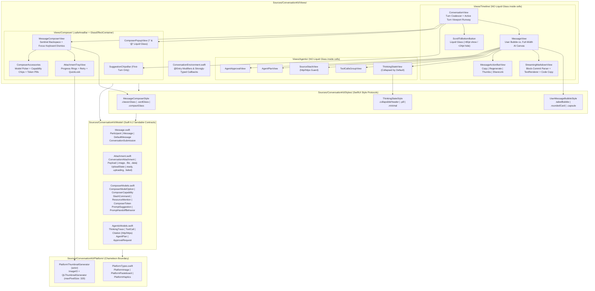

# 🏛️ ADR-0001: ConversationKit v2 — Clean-Slate Native Liquid Glass, Top-Floating Turn Physics, and Agentic Chat Architecture

- **Status**: Accepted
- **Date**: 2026-11-01
- **Author**: Senior Architect (`@senior-architect`) & Swift SDK Architect (`@swift-sdk-architect`)
- **Related Spec**: [`docs/specs/PRD-0001-CONVERSATIONKIT-V2.md`](../specs/PRD-0001-CONVERSATIONKIT-V2.md)
- **Target Branch / Version**: `v2` (`v2.0.0`)
- **Platform & Language Baseline**: iOS 26.0+, iPadOS 26.0+, macCatalyst 26.0+, macOS 26.0+ | Swift 6.2 (`swift-tools-version: 6.2`), Strict Concurrency, Zero External Dependencies

---

## 1. Context & Problem Statement

`ConversationKit` v1 was architected around human-to-human messaging assumptions (bubble-for-all participants, image-only attachments, single-layout composer, and pre-iOS 26 blur materials). Modern conversational AI and agentic applications on Apple platforms in 2026 expose five critical architectural forces that require a clean-slate v2 design:

1. **Deterministic Top-Floating Scroll Physics vs. Streaming Content Growth (`F-1`, `F-2`, `F-10`):**
   - When a user submits a prompt, the prompt must glide smoothly to the top of the visible viewport (`anchor: .top`) in a single render transaction alongside keyboard dismissal—without down-up bounce or duplicate message flash.
   - However, in standard `ScrollView` + `LazyVStack` layouts, `proxy.scrollTo(userMessageID, anchor: .top)` is clamped by the scroll view's maximum content offset (`contentSize.height - viewportHeight`). If there is no space below the newly inserted user message, `ScrollView` refuses to scroll the user message to the top of the screen.
   - Conversely, if the layout calls `scrollTo` on every streaming token, or pins to `.bottom`, long AI responses (>100% viewport height) push the user's prompt off the top of the screen and induce severe per-token vertical jitter ($\Delta Y \neq 0\text{pt}$).

2. **Asymmetric Participant Chrome & Agentic Surface Density (`F-3`, `F-7`):**
   - User prompts are short, personal utterances with attached media/files and belong in a right-aligned stylable bubble (`UserMessageBubbleStyle`).
   - Assistant responses contain wide multi-block Markdown, syntax-highlighted code blocks, collapsible reasoning traces (`ThinkingStateView` collapsed by default), tool execution timelines (`ToolCallsGroupView`), source citation stacks (`SourceStackView`), execution plans (`AgentPlanView`), and human-in-the-loop approvals (`AgentApprovalView`). Wrapping these in a constricted bubble wastes horizontal canvas and degrades scannability.

3. **Universal Multimodal Attachments & Memory Budgets (`F-4`):**
   - Supporting images, PDFs, audio, source code, and arbitrary `UTType` documents via `URL` or raw `Data` requires off-main-thread thumbnail downsampling (`ImageIO` / `QLThumbnailGenerator`), determinate upload progress rings (`0.0...1.0`), per-item retry, submission gating during active uploads, and native QuickLook previewing without decoding full-resolution bitmaps on `@MainActor`.

4. **Structured Prompting, Token Field Ergonomics & Composer Customization (`F-5`, `F-8`, `F-9`, `F-11`):**
   - Modern AI composers integrate `/` slash commands, `@` resource mentions (static and debounced async providers), removable token pills, double-backspace token deletion on empty input, model/capability pickers, first-turn suggestion chips, and a focus-driven keyboard dismiss button (`keyboard.chevron.compact.down`).
   - Coupling these state machines to a fixed view hierarchy prevents consumers from switching between classic detached buttons (`.classicGlass`), unified two-row AI cards (`.cardGlass`), and compact capsules (`.compactGlass`).

5. **Native iOS 26+ Liquid Glass & Chameleon Cross-Platform Isolation (`F-6`, `AC-2`, `AC-10`):**
   - iOS 26 and macOS 26 introduce native Liquid Glass (`GlassEffectContainer`, `.glassEffect(.regular.interactive(), in: ...)`, `.buttonStyle(.glass)`, `.buttonStyle(.glassProminent)`, `.safeAreaBar(edge: .bottom)`). Applying `.glassEffect` inside scrolling `ScrollView` cells causes GPU offscreen-pass frame drops and violates Apple HIG. Furthermore, UIKit and AppKit divergences must be strictly isolated inside `Sources/ConversationKit/Platform/`.

---

## 2. Decision

We will architect **ConversationKit v2** from a clean slate around six foundational decisions and strict architectural invariants:

1. **Chameleon Platform Layer (`Sources/ConversationKit/Platform/PlatformTypes.swift`):** Centralize all UIKit/AppKit type aliases (`PlatformImage`), pasteboard access, security-scoped URL helpers, haptics, and off-main-thread `PlatformThumbnailGenerator` (`ImageIO` + `QLThumbnailGenerator`) into `Platform/`. Zero `#if canImport(UIKit)` / `#if canImport(AppKit)` blocks are permitted in `Model/`, `Styles/`, or `Views/`.
2. **Stratos 4-Layer Progressive Disclosure & 2-Generic `ConversationView<MessageType, Content>` (`Sources/ConversationKit/Model/`, `[MF-2]`):** Define `Sendable`, `Identifiable`, `Hashable` value models (`DefaultMessage`, `ConversationAttachment`, `ComposerModels`, `AgenticModels`, `ConversationSubmission<MessageType>`) and defaulted `Message` protocol extensions. Standardize `ConversationView<MessageType: Message, Content: View>` on 2 generic parameters with an internal `@State private var internalAttachments: [ConversationAttachment] = []` fallback when `attachments:` is omitted, so Troposphere callers need only `ConversationView(messages: $messages)` while Thermosphere callers can bind custom domain types with zero `as?` downcasting.
3. **SwiftUI `Style` + `StyleConfiguration` Protocols (`Sources/ConversationKit/Styles/`, `[MF-1]`):** Decouple state/focus/token orchestration from visual layout via `MessageComposerStyle` (`.classicGlass` / `.automatic`, `.cardGlass`, `.compactGlass`), `ThinkingStateStyle` (`.collapsibleHeader` / `.default` / `.automatic`, `.pill`, `.minimal`), and `UserMessageBubbleStyle` (`.tailedBubble` / `.standard` / `.automatic`, `.roundedCard`, `.capsule` — strictly opaque/tinted semantic surfaces with zero Liquid Glass inside scrolling cells).
4. **Turn-Grouped Timeline with Unoccluded Active Viewport Runway (`Sources/ConversationKit/Views/Timeline/`, `[MF-3]`):** Group flat `messages` into `ConversationTurn<MessageType>` units (`userMessage` + `assistantMessages`). Compute and lock `activeTurnMinHeight` from the **unoccluded** viewport height (`unoccludedViewportHeight - topSafeInset - composerBarHeight`) so transient keyboard dismissal safe-area/inset changes never shift or re-layout the active turn container, allowing a single `proxy.scrollTo(activeTurn.id, anchor: .top)` on send to immediately float the user bubble to the top edge with $\Delta Y = 0\text{pt}$ throughout streaming overflow.
5. **Bottom `.safeAreaBar` Liquid Glass Chrome & Sentinel-Backed Token Composer (`Sources/ConversationKit/Views/Composer/`, `[MF-5]`):** Host `SuggestionChipsBar`, `ComposerPopupView`, and `MessageComposerView` inside `.safeAreaBar(edge: .bottom)` using `GlassEffectContainer` and `@Namespace` `.glassEffectID` morphing. Implement a zero-width space (`\u{200B}`) sentinel in the composer text binding when tokens are present so iOS software keyboards reliably emit backspace events on a visually empty draft, stripping all `\u{200B}` occurrences globally (`replacingOccurrences(of: "\u{200B}", with: "")`) before exposing text to callers or evaluating `canSubmit`.
6. **Incremental Block-Committed `StreamingMarkdownView` (`Sources/ConversationKit/Views/Timeline/StreamingMarkdownView.swift`, `[MF-5]`):** Buffer bursty incoming chunks with an adaptive cadence smoother, freeze completed Markdown AST blocks by stable block index/hash so only the active trailing block re-parses per token, apply a SwiftUI `TextRenderer` for per-word ink fade and an inline cap-height cursor, and enforce `URL.isAllowedConversationURL` (`http`/`https` only) on both Markdown links and `SourceStackView`.

### Architectural Invariants
1. **Invariant 1 (Zero Platform Leakage):** `grep -rnE '#if canImport\((UIKit|AppKit)\)' Sources/ConversationKit/{Model,Styles,Views}` MUST return `0` matches (`AC-2`).
2. **Invariant 2 (Zero Liquid Glass in Scrolling Cells):** `grep -rn '\.glassEffect' Sources/ConversationKit/Views/{Timeline,Agentic}/` (excluding `ScrollToBottomButton.swift`) MUST return `0` matches (`AC-10`, `[MF-1]`).
3. **Invariant 3 (Zero-Jitter Top-Floating Turn Anchor):** During AI token streaming—including when the response exceeds `150%` of viewport height and while the software keyboard dismisses—`ConversationView` locks `activeTurnMinHeight` to the unoccluded viewport height and MUST NOT invoke `scrollTo` per token, preserving $\Delta Y = 0\text{pt}$ on the active turn's user message bubble (`AC-3`, `AC-4`, `[MF-3]`).
4. **Invariant 4 (Strict Swift 6.2 Concurrency, $O(1)$ Image Identity & Main-Thread Bitmap Ban):** All public models conform to `Sendable`. `PlatformImageBox` uses $O(1)$ `UUID` identity equality (`[MF-4]`) with lazy PNG encoding. Full-resolution image/PDF decoding on `@MainActor` is forbidden; all thumbnails and QuickLook temporary files are generated off the main actor via `PlatformThumbnailGenerator` (`maxPixelSize: 320`) (`AC-1`, `AC-6`, `[MF-4]`).
5. **Invariant 5 (Untrusted URL Allowlisting & Path Sanitization):** `URL.isAllowedConversationURL` (`http` and `https` with non-empty host) is enforced on both `Citation.sanitizedURL` (`SourceStackView`) and `StreamingMarkdownView`'s `openURL` handler, and QuickLook temp files sanitize `lastPathComponent` inside a `UUID` directory (`AC-18`, `[MF-5]`).

---

## 3. Architecture & Component Breakdown

### 3.1 Repository & Module Mapping

```text
Sources/ConversationKit/
├── ConversationKit.swift                        // Public module namespace & version metadata
├── Platform/
│   └── PlatformTypes.swift                      // PlatformImage, PlatformPasteboard, PlatformHaptics, PlatformThumbnailGenerator
├── Model/
│   ├── Message.swift                            // Participant, Message protocol + default extensions, DefaultMessage, ConversationSubmission
│   ├── Attachment.swift                         // ConversationAttachment, Payload (.image, .file, .data), UploadState, AttachmentMetadata
│   ├── ComposerModels.swift                     // ComposerModelOption, ComposerCapability, SlashCommand, ResourceMention, ComposerToken, PromptSuggestion, PromptHandoffBehavior
│   └── AgenticModels.swift                      // ThinkingTrace, ToolCall, Citation, AgentPlan, ApprovalRequest, MessageFeedback
├── Styles/
│   ├── MessageComposerStyle.swift               // MessageComposerStyle, MessageComposerStyleConfiguration, .classicGlass, .cardGlass, .compactGlass
│   ├── ThinkingStateStyle.swift                 // ThinkingStateStyle, ThinkingStateStyleConfiguration, .collapsibleHeader, .pill, .minimal
│   └── UserMessageBubbleStyle.swift             // UserMessageBubbleStyle, UserMessageBubbleStyleConfiguration, .tailedBubble, .roundedCard, .capsule
└── Views/
    ├── ConversationEnvironment.swift            // @Entry environment values & Stratos view modifiers
    ├── Timeline/
    │   ├── ConversationView.swift               // Turn grouping engine, active turn viewport runway, scroll tracking & retry coordinator
    │   ├── ConversationTurn.swift               // Internal deterministic turn coalescer (User prompt + Assistant response items)
    │   ├── MessageView.swift                    // Asymmetric participant router (UserMessageBubbleStyle vs full-width AI canvas)
    │   ├── StreamingMarkdownView.swift          // Cadence smoother, block-commit parser, TextRenderer word fade + cursor, copyable code blocks
    │   ├── MessageActionBarView.swift           // Copy, Regenerate, Thumbs Up/Down, ShareLink
    │   └── ScrollToBottomButton.swift           // Floating Liquid Glass button driven by >80pt / <24pt hysteresis
    ├── Composer/
    │   ├── MessageComposerView.swift            // Focus, sentinel backspace, autocomplete trigger parser, upload gate & style host
    │   ├── SuggestionChipsBar.swift             // First-turn view-aligned snapping Liquid Glass suggestion rail
    │   ├── AttachmentTrayView.swift             // Pending attachments strip with progress rings, retry, remove & QuickLook
    │   ├── ComposerPopupView.swift              // Floating Liquid Glass '/' & '@' autocomplete list with substring highlighting
    │   └── ComposerAccessories.swift            // Model selector menu pill, capability toggle chips, removable ComposerToken pills
    └── Agentic/
        ├── ThinkingStateView.swift              // Collapsed-by-default reasoning trace with phase-locked mark, sheen & tabular timer
        ├── ToolCallsGroupView.swift             // Collapsible tool call group, morphing icons, live timers, JSON inspector & retry
        ├── SourceStackView.swift                // Overlapping domain badge pill + expandable numbered citation cards
        ├── AgentPlanView.swift                  // Step-by-step execution checklist card
        └── AgentApprovalView.swift              // Human-in-the-loop Allow Once / Always Allow / Deny card
```

---

### 3.2 Complete Public Swift 6.2 Type Signatures & Data Models (`Sources/ConversationKit/Model/`)

#### 3.2.1 `Sources/ConversationKit/Platform/PlatformTypes.swift`

```swift
import Foundation
import SwiftUI
import UniformTypeIdentifiers
import ImageIO
import QuickLookThumbnailing

#if canImport(UIKit)
import UIKit
public typealias PlatformImage = UIImage
#elseif canImport(AppKit)
import AppKit
public typealias PlatformImage = NSImage
#endif

extension PlatformImage: @unchecked Sendable {}

public enum PlatformHapticEvent: Sendable {
  case messageSent
  case chipSelected
  case tokenInserted
  case tokenRemoved
  case copied
  case warning
  case error
}

public actor PlatformThumbnailGenerator {
  public static let shared = PlatformThumbnailGenerator()

  private let cache = NSCache<NSString, PlatformImage>()

  public init() {
    cache.countLimit = 128
  }

  /// Generates a memory-safe downsampled thumbnail off the main thread.
  /// Never decodes full-resolution bitmaps onto @MainActor.
  public func thumbnail(
    for attachment: ConversationAttachment,
    maxPixelSize: CGFloat = 320,
    scale: CGFloat = 2.0
  ) async throws -> PlatformImage

  /// Resolves a sanitized local `URL` suitable for SwiftUI's `.quickLookPreview(_:)` off the main actor (`[MF-4]`, `[MF-5]`).
  /// - For `.file(url)`: validates file existence and returns `url`.
  /// - For `.image` or `.data`: sanitizes `attachment.filename` via `URL(fileURLWithPath: filename).lastPathComponent`
  ///   (preventing `../` path traversal) inside a per-attachment UUID directory under
  ///   `FileManager.default.temporaryDirectory.appending(path: "ConversationKitQuickLook/\(UUID(uuidString: attachment.id)?.uuidString ?? UUID().uuidString)")`.
  public func resolveQuickLookURL(for attachment: ConversationAttachment) async throws -> URL
}
```

#### 3.2.2 `Sources/ConversationKit/Model/Message.swift`

```swift
import Foundation
import SwiftUI

/// Identifies the author role of a message in the conversation timeline.
public enum Participant: String, Sendable, Hashable, Codable, CaseIterable {
  case user
  case other
}

/// Optional user rating feedback on an assistant message.
public enum MessageFeedback: String, Sendable, Hashable, Codable {
  case thumbsUp
  case thumbsDown
}

/// Core protocol representing a single message in `ConversationView`.
/// Defaulted extension properties enable Stratos Progressive Disclosure so simple
/// implementations only need `id`, `content`, and `participant`.
public protocol Message: Identifiable, Hashable, Sendable where ID == String {
  var id: String { get }
  var content: String? { get }
  var participant: Participant { get }
  var timestamp: Date { get }

  // Multimodal & Composer Context
  var attachments: [ConversationAttachment] { get }
  var tokens: [ComposerToken] { get }

  // Agentic & Reasoning Primitives (Defaulted to nil / empty via extension)
  var thinkingTrace: ThinkingTrace? { get }
  var toolCalls: [ToolCall] { get }
  var citations: [Citation] { get }
  var plan: AgentPlan? { get }
  var approvalRequest: ApprovalRequest? { get }

  // Lifecycle & Error State
  var isStreaming: Bool { get }
  var errorMessage: String? { get }
  var feedback: MessageFeedback? { get }

  /// Factory requirement used by `ConversationView` to construct a strongly-typed
  /// user message on submission without requiring `as?` downcasting.
  static func makeUserMessage(
    id: String,
    content: String,
    attachments: [ConversationAttachment],
    tokens: [ComposerToken]
  ) -> Self
}

extension Message {
  public var timestamp: Date { .now }
  public var attachments: [ConversationAttachment] { [] }
  public var tokens: [ComposerToken] { [] }
  public var thinkingTrace: ThinkingTrace? { nil }
  public var toolCalls: [ToolCall] { [] }
  public var citations: [Citation] { [] }
  public var plan: AgentPlan? { nil }
  public var approvalRequest: ApprovalRequest? { nil }
  public var isStreaming: Bool { false }
  public var errorMessage: String? { nil }
  public var feedback: MessageFeedback? { nil }
}

/// Batteries-included concrete `Message` model supporting full multimodal and agentic metadata.
public struct DefaultMessage: Message, Codable {
  public var id: String
  public var content: String?
  public var participant: Participant
  public var timestamp: Date
  public var attachments: [ConversationAttachment]
  public var tokens: [ComposerToken]
  public var thinkingTrace: ThinkingTrace?
  public var toolCalls: [ToolCall]
  public var citations: [Citation]
  public var plan: AgentPlan?
  public var approvalRequest: ApprovalRequest?
  public var isStreaming: Bool
  public var errorMessage: String?
  public var feedback: MessageFeedback?

  public init(
    id: String = UUID().uuidString,
    content: String? = nil,
    participant: Participant = .user,
    timestamp: Date = .now,
    attachments: [ConversationAttachment] = [],
    tokens: [ComposerToken] = [],
    thinkingTrace: ThinkingTrace? = nil,
    toolCalls: [ToolCall] = [],
    citations: [Citation] = [],
    plan: AgentPlan? = nil,
    approvalRequest: ApprovalRequest? = nil,
    isStreaming: Bool = false,
    errorMessage: String? = nil,
    feedback: MessageFeedback? = nil
  ) {
    self.id = id
    self.content = content
    self.participant = participant
    self.timestamp = timestamp
    self.attachments = attachments
    self.tokens = tokens
    self.thinkingTrace = thinkingTrace
    self.toolCalls = toolCalls
    self.citations = citations
    self.plan = plan
    self.approvalRequest = approvalRequest
    self.isStreaming = isStreaming
    self.errorMessage = errorMessage
    self.feedback = feedback
  }

  public static func makeUserMessage(
    id: String = UUID().uuidString,
    content: String,
    attachments: [ConversationAttachment] = [],
    tokens: [ComposerToken] = []
  ) -> DefaultMessage {
    DefaultMessage(
      id: id,
      content: content,
      participant: .user,
      timestamp: .now,
      attachments: attachments,
      tokens: tokens
    )
  }
}

/// Strongly-typed submission payload emitted by `ConversationView` when a user sends a prompt.
/// Eliminates all `any Message` downcasting (`AC-19`).
public struct ConversationSubmission<MessageType: Message>: Sendable, Equatable {
  /// The newly constructed user message with a stable `id` matching the optimistic UI turn anchor.
  public let message: MessageType
  /// Plain-text prompt with the internal zero-width sentinel stripped.
  public let text: String
  /// Attached files, photos, PDFs, or data blobs at the time of submission.
  public let attachments: [ConversationAttachment]
  /// Structured `/command` and `@mention` tokens attached to this submission.
  public let tokens: [ComposerToken]
  /// The active `ComposerModelOption` selected in the composer, if configured.
  public let selectedModel: ComposerModelOption?
  /// The set of active `ComposerCapability` toggles (`Think`, `Search`, `Image`, etc.).
  public let activeCapabilities: Set<ComposerCapability>

  public init(
    message: MessageType,
    text: String,
    attachments: [ConversationAttachment],
    tokens: [ComposerToken],
    selectedModel: ComposerModelOption? = nil,
    activeCapabilities: Set<ComposerCapability> = []
  ) {
    self.message = message
    self.text = text
    self.attachments = attachments
    self.tokens = tokens
    self.selectedModel = selectedModel
    self.activeCapabilities = activeCapabilities
  }
}
```

#### 3.2.3 `Sources/ConversationKit/Model/Attachment.swift`

```swift
import Foundation
import UniformTypeIdentifiers

/// Universal multimodal attachment model supporting images, PDFs, audio, code/text, and arbitrary files.
public struct ConversationAttachment: Identifiable, Hashable, Sendable, Codable {
  /// Storage representation for an attachment.
  public enum Payload: Sendable, Hashable, Codable {
    case image(PlatformImageBox)
    case file(URL)
    case data(Data, contentType: UTType, filename: String)
  }

  /// Upload lifecycle state used by `AttachmentTrayView` to render determinate progress rings
  /// and gate message submission (`canSubmit == false` unless all attachments are `.ready`, `[MF-5]`).
  public enum UploadState: Sendable, Hashable, Codable {
    case ready
    case uploading(progress: Double)
    case failed(error: String)
  }

  /// High-level semantic category used for layout routing (collage grid vs. file chip).
  public enum Kind: String, Sendable, Hashable, Codable {
    case image
    case pdf
    case audio
    case code
    case document
  }

  public let id: String
  public var payload: Payload
  public var filename: String
  public var contentType: UTType
  public var fileSizeBytes: Int64?
  public var uploadState: UploadState

  /// Convenience property (`0.0...1.0`) when `uploadState` is `.uploading(progress:)`, otherwise `nil`.
  public var uploadProgress: Double? {
    if case .uploading(let progress) = uploadState {
      return min(max(progress, 0.0), 1.0)
    }
    return nil
  }

  /// Convenience error description when `uploadState` is `.failed(error:)`, otherwise `nil`.
  public var uploadError: String? {
    if case .failed(let error) = uploadState {
      return error
    }
    return nil
  }

  /// Semantic attachment kind derived from `payload` and `contentType`.
  public var kind: Kind {
    switch payload {
    case .image:
      return .image
    case .file, .data:
      if contentType.conforms(to: .image) { return .image }
      if contentType.conforms(to: .pdf) { return .pdf }
      if contentType.conforms(to: .audio) { return .audio }
      if contentType.conforms(to: .sourceCode) || contentType.conforms(to: .plainText) { return .code }
      return .document
    }
  }

  /// Human-readable byte count (e.g., `"2.4 MB"`) or localized `UTType` description.
  public var formattedSubtitle: String { ... }

  public init(
    id: String = UUID().uuidString,
    payload: Payload,
    filename: String? = nil,
    contentType: UTType? = nil,
    fileSizeBytes: Int64? = nil,
    uploadState: UploadState = .ready
  )

  public static func image(
    id: String = UUID().uuidString,
    _ image: PlatformImage,
    filename: String = "Image.jpg",
    uploadState: UploadState = .ready
  ) -> ConversationAttachment

  public static func file(
    id: String = UUID().uuidString,
    url: URL,
    contentType: UTType? = nil,
    fileSizeBytes: Int64? = nil,
    uploadState: UploadState = .ready
  ) -> ConversationAttachment

  public static func data(
    id: String = UUID().uuidString,
    _ data: Data,
    contentType: UTType,
    filename: String,
    uploadState: UploadState = .ready
  ) -> ConversationAttachment

  /// Resolves a local `URL` suitable for SwiftUI's `.quickLookPreview(_:)` by delegating to
  /// `PlatformThumbnailGenerator.shared.resolveQuickLookURL(for: self)` (`[MF-4]`, `[MF-5]`).
  /// Sanitizes `filename` via `URL(fileURLWithPath: filename).lastPathComponent` inside a
  /// per-attachment `UUID` subdirectory under `FileManager.default.temporaryDirectory`.
  public func resolveQuickLookURL() async throws -> URL {
    try await PlatformThumbnailGenerator.shared.resolveQuickLookURL(for: self)
  }
}

/// Sendable, Hashable, Codable value wrapper around `PlatformImage` with $O(1)$ UUID identity (`[MF-4]`).
/// Defers PNG encoding until `encode(to:)` or `encodedPNGData()` is actually requested, avoiding
/// main-thread bitmap compression or multi-megabyte byte hashing during SwiftUI view diffing.
public struct PlatformImageBox: Identifiable, Sendable, Hashable, Codable {
  public let id: UUID
  public let image: PlatformImage
  private let cachedData: Data?

  public init(id: UUID = UUID(), _ image: PlatformImage, cachedData: Data? = nil) {
    self.id = id
    self.image = image
    self.cachedData = cachedData
  }

  /// $O(1)$ identity equality so SwiftUI `Equatable` / `Hashable` checks never hash raw PNG bytes (`[MF-4]`).
  public static func == (lhs: PlatformImageBox, rhs: PlatformImageBox) -> Bool {
    lhs.id == rhs.id
  }

  public func hash(into hasher: inout Hasher) {
    hasher.combine(id)
  }

  /// Lazily encodes PNG data off the hot initialization path when needed for `Codable` or QuickLook export.
  public func encodedPNGData() -> Data
}
```

#### 3.2.4 `Sources/ConversationKit/Model/ComposerModels.swift`

```swift
import Foundation

/// Represents an AI model choice displayed in the composer's integrated Model Selector menu (`F-9`).
public struct ComposerModelOption: Identifiable, Hashable, Sendable, Codable {
  public let id: String
  public var title: String
  public var subtitle: String?
  public var systemImage: String
  public var badge: String?

  public init(
    id: String,
    title: String,
    subtitle: String? = nil,
    systemImage: String = "sparkles",
    badge: String? = nil
  ) {
    self.id = id
    self.title = title
    self.subtitle = subtitle
    self.systemImage = systemImage
    self.badge = badge
  }
}

/// Represents a toggleable capability chip inside the composer (e.g. `Think`, `Search`, `Image`).
public struct ComposerCapability: Identifiable, Hashable, Sendable, Codable {
  public let id: String
  public var title: String
  public var systemImage: String

  public init(id: String, title: String, systemImage: String) {
    self.id = id
    self.title = title
    self.systemImage = systemImage
  }

  public static let thinking = ComposerCapability(id: "thinking", title: "Think", systemImage: "brain")
  public static let webSearch = ComposerCapability(id: "webSearch", title: "Search", systemImage: "globe")
  public static let imageGeneration = ComposerCapability(id: "imageGeneration", title: "Image", systemImage: "photo.badge.plus")
}

/// Defines a `/` slash command entry shown in `ComposerPopupView` (`F-5`).
public struct SlashCommand: Identifiable, Hashable, Sendable, Codable {
  public let id: String
  /// Command trigger without the leading slash (e.g., `"summarize"`).
  public var trigger: String
  public var title: String
  public var description: String?
  public var systemImage: String

  public init(
    id: String = UUID().uuidString,
    trigger: String,
    title: String,
    description: String? = nil,
    systemImage: String = "command"
  ) {
    self.id = id
    self.trigger = trigger
    self.title = title
    self.description = description
    self.systemImage = systemImage
  }
}

/// Type alias preserving terminology parity with PRD `CommandItem`.
public typealias CommandItem = SlashCommand

/// Defines an `@` resource mention entry shown in `ComposerPopupView` (`F-5`).
public struct ResourceMention: Identifiable, Hashable, Sendable, Codable {
  public let id: String
  /// Handle or filename matched after `@` (e.g., `"PRD-0001"`).
  public var handle: String
  public var title: String
  public var subtitle: String?
  public var systemImage: String
  public var category: String?

  public init(
    id: String = UUID().uuidString,
    handle: String,
    title: String,
    subtitle: String? = nil,
    systemImage: String = "doc.text",
    category: String? = nil
  ) {
    self.id = id
    self.handle = handle
    self.title = title
    self.subtitle = subtitle
    self.systemImage = systemImage
    self.category = category
  }
}

/// Type alias preserving terminology parity with PRD `MentionItem`.
public typealias MentionItem = ResourceMention

/// Async search provider closure for dynamic `@mention` resolution with cooperative cancellation.
public typealias ResourceMentionProvider = @Sendable (_ query: String) async throws -> [ResourceMention]

/// Structured token pill inserted into `MessageComposerView` when a `/` command or `@` mention is chosen.
public struct ComposerToken: Identifiable, Hashable, Sendable, Codable {
  public enum Kind: Sendable, Hashable, Codable {
    case slashCommand(SlashCommand)
    case resourceMention(ResourceMention)
  }

  public let id: String
  public let kind: Kind

  public var displayText: String {
    switch kind {
    case .slashCommand(let cmd): return "/\(cmd.trigger)"
    case .resourceMention(let mention): return "@\(mention.title)"
    }
  }

  public var systemImage: String {
    switch kind {
    case .slashCommand(let cmd): return cmd.systemImage
    case .resourceMention(let mention): return mention.systemImage
    }
  }

  public init(id: String = UUID().uuidString, kind: Kind) {
    self.id = id
    self.kind = kind
  }

  public static func command(_ command: SlashCommand) -> ComposerToken {
    ComposerToken(id: "cmd-\(command.id)", kind: .slashCommand(command))
  }

  public static func mention(_ mention: ResourceMention) -> ComposerToken {
    ComposerToken(id: "mention-\(mention.id)", kind: .resourceMention(mention))
  }
}

/// Determines how tapping a first-turn `PromptSuggestion` chip interacts with the composer (`F-8`).
public enum PromptHandoffBehavior: Sendable, Hashable, Codable {
  /// Immediately constructs and submits the user message in a single tap.
  case immediateSend
  /// Populates the composer text field and focuses `@FocusState` for user editing.
  case populateComposer
}

/// A first-turn suggestion chip rendered in `SuggestionChipsBar` above the composer (`F-8`).
public struct PromptSuggestion: Identifiable, Hashable, Sendable, Codable {
  public let id: String
  public var title: String
  public var subtitle: String?
  public var prompt: String
  public var systemImage: String?
  public var behavior: PromptHandoffBehavior

  public init(
    id: String = UUID().uuidString,
    title: String,
    subtitle: String? = nil,
    prompt: String? = nil,
    systemImage: String? = nil,
    behavior: PromptHandoffBehavior = .immediateSend
  ) {
    self.id = id
    self.title = title
    self.subtitle = subtitle
    self.prompt = prompt ?? title
    self.systemImage = systemImage
    self.behavior = behavior
  }
}

/// Type alias preserving terminology parity with PRD `SuggestionChip`.
public typealias SuggestionChip = PromptSuggestion
```

#### 3.2.5 `Sources/ConversationKit/Model/AgenticModels.swift`

```swift
import Foundation

/// Represents the reasoning / chain-of-thought trace rendered by `ThinkingStateView` (`F-7`).
/// `ThinkingStateView` always defaults its `@State private var isExpanded: Bool = false`
/// unless explicitly overridden by `defaultExpanded`.
public struct ThinkingTrace: Identifiable, Hashable, Sendable, Codable {
  public enum Status: Sendable, Hashable, Codable {
    case thinking(startedAt: Date)
    case completed(duration: TimeInterval)
    case cancelled(duration: TimeInterval)
  }

  public let id: String
  public var title: String?
  public var content: String
  public var status: Status
  /// Defaults to `false` so `ThinkingStateView` renders collapsed by default (`F-7`, `AC-11`).
  public var defaultExpanded: Bool

  public var isStreaming: Bool {
    if case .thinking = status { return true }
    return false
  }

  public init(
    id: String = UUID().uuidString,
    title: String? = nil,
    content: String,
    status: Status,
    defaultExpanded: Bool = false
  ) {
    self.id = id
    self.title = title
    self.content = content
    self.status = status
    self.defaultExpanded = defaultExpanded
  }
}

/// Represents an individual agentic tool invocation rendered inside `ToolCallsGroupView`.
public struct ToolCall: Identifiable, Hashable, Sendable, Codable {
  public enum Status: Sendable, Hashable, Codable {
    case running(startedAt: Date)
    case succeeded(duration: TimeInterval)
    case failed(duration: TimeInterval, error: String)
  }

  public let id: String
  public var name: String
  public var title: String
  public var systemImage: String
  public var argumentsJSON: String?
  public var resultJSON: String?
  public var status: Status

  public init(
    id: String = UUID().uuidString,
    name: String,
    title: String,
    systemImage: String = "wrench.and.screwdriver",
    argumentsJSON: String? = nil,
    resultJSON: String? = nil,
    status: Status
  ) {
    self.id = id
    self.name = name
    self.title = title
    self.systemImage = systemImage
    self.argumentsJSON = argumentsJSON
    self.resultJSON = resultJSON
    self.status = status
  }
}

extension URL {
  /// Shared allowlist validator used by both `SourceStackView` (`Citation.sanitizedURL`) and
  /// `StreamingMarkdownView` (`OpenURLAction`) (`AC-18`, `[MF-5]`).
  /// Permits only `http` and `https` URLs with a non-empty host; rejects `javascript:`, `file:`, `data:`, etc.
  public var isAllowedConversationURL: Bool {
    guard
      let scheme = self.scheme?.lowercased(),
      Citation.allowedSchemes.contains(scheme),
      let host = self.host(),
      !host.isEmpty
    else {
      return false
    }
    return true
  }
}

/// Represents an external source citation rendered inside `SourceStackView` with strict URL allowlisting (`AC-18`, `[MF-5]`).
public struct Citation: Identifiable, Hashable, Sendable, Codable {
  public static let allowedSchemes: Set<String> = ["http", "https"]

  public let id: String
  public var index: Int
  public var title: String
  public var domain: String
  public var rawURLString: String
  public var snippet: String?

  /// Returns a validated `URL` only if `url.isAllowedConversationURL == true` (`http`/`https` + non-empty host).
  /// Rejects `javascript:`, `file:`, `data:`, and arbitrary custom schemes (`AC-18`, `[MF-5]`).
  public var sanitizedURL: URL? {
    guard let url = URL(string: rawURLString), url.isAllowedConversationURL else {
      return nil
    }
    return url
  }

  public init(
    id: String = UUID().uuidString,
    index: Int,
    title: String,
    domain: String? = nil,
    urlString: String,
    snippet: String? = nil
  ) {
    self.id = id
    self.index = index
    self.title = title
    self.rawURLString = urlString
    self.snippet = snippet
    if let domain, !domain.isEmpty {
      self.domain = domain
    } else if let host = URL(string: urlString)?.host() {
      self.domain = host.replacingOccurrences(of: "^www\\.", with: "", options: .regularExpression)
    } else {
      self.domain = "source"
    }
  }
}

/// Represents a multi-step execution plan rendered by `AgentPlanView`.
public struct AgentPlan: Identifiable, Hashable, Sendable, Codable {
  public struct Step: Identifiable, Hashable, Sendable, Codable {
    public enum Status: String, Sendable, Hashable, Codable {
      case pending
      case inProgress
      case completed
      case skipped
      case failed
    }

    public let id: String
    public var title: String
    public var detail: String?
    public var status: Status

    public init(
      id: String = UUID().uuidString,
      title: String,
      detail: String? = nil,
      status: Status = .pending
    ) {
      self.id = id
      self.title = title
      self.detail = detail
      self.status = status
    }
  }

  public let id: String
  public var title: String
  public var steps: [Step]

  public init(id: String = UUID().uuidString, title: String, steps: [Step]) {
    self.id = id
    self.title = title
    self.steps = steps
  }
}

/// Represents a human-in-the-loop permission request rendered by `AgentApprovalView` (`AC-18`).
public struct ApprovalRequest: Identifiable, Hashable, Sendable, Codable {
  public enum Decision: String, Sendable, Hashable, Codable {
    case allowOnce
    case alwaysAllow
    case deny
  }

  public enum RiskLevel: String, Sendable, Hashable, Codable {
    case low
    case medium
    case destructive
  }

  public let id: String
  public var title: String
  public var summary: String
  public var toolName: String?
  public var commandPreview: String?
  public var riskLevel: RiskLevel
  public var decision: Decision?

  public var isResolved: Bool { decision != nil }

  public init(
    id: String = UUID().uuidString,
    title: String,
    summary: String,
    toolName: String? = nil,
    commandPreview: String? = nil,
    riskLevel: RiskLevel = .medium,
    decision: Decision? = nil
  ) {
    self.id = id
    self.title = title
    self.summary = summary
    self.toolName = toolName
    self.commandPreview = commandPreview
    self.riskLevel = riskLevel
    self.decision = decision
  }
}
```

---

### 3.3 SwiftUI `Style` Protocols (`Sources/ConversationKit/Styles/`)

#### 3.3.1 `Sources/ConversationKit/Styles/MessageComposerStyle.swift`

```swift
import SwiftUI

/// Defines the visual layout and Liquid Glass arrangement of `MessageComposerView` (`AC-16`).
@MainActor
public protocol MessageComposerStyle: DynamicProperty {
  associatedtype Body: View
  typealias Configuration = MessageComposerStyleConfiguration

  @ViewBuilder @MainActor
  func makeBody(configuration: Configuration) -> Body
}

/// The subviews and state properties passed to a `MessageComposerStyle` implementation.
public struct MessageComposerStyleConfiguration {
  public let textField: AnyView              // Vertical-growing text field
  public let attachmentButton: AnyView?      // '+' menu trigger button
  public let attachmentsTray: AnyView?       // Horizontal pending attachments tray
  public let tokensBar: AnyView?             // Active '/command' & '@mention' token pills
  public let modelSelector: AnyView?         // Integrated Model Selector menu pill
  public let capabilitiesBar: AnyView?       // Capability toggle pills (Think, Search, Image)
  public let dictationButton: AnyView?       // Optional voice/dictation button
  public let submitButton: AnyView           // Send / Stop button
  public let dismissKeyboardButton: AnyView? // 'keyboard.chevron.compact.down' when focused

  public let isFocused: Bool
  public let isGenerating: Bool
  public let canSubmit: Bool
  public let hasAttachments: Bool
  public let hasTokens: Bool
}

public struct ClassicGlassMessageComposerStyle: MessageComposerStyle {
  public init() {}
  @MainActor public func makeBody(configuration: Configuration) -> some View
}

public struct CardGlassMessageComposerStyle: MessageComposerStyle {
  public init() {}
  @MainActor public func makeBody(configuration: Configuration) -> some View
}

public struct CompactGlassMessageComposerStyle: MessageComposerStyle {
  public init() {}
  @MainActor public func makeBody(configuration: Configuration) -> some View
}

extension MessageComposerStyle where Self == ClassicGlassMessageComposerStyle {
  /// Default style: Detached circular 44×44pt '+' button, central Liquid Glass pill (cornerRadius: 22),
  /// and detached trailing 44×44pt circular `keyboard.chevron.compact.down` button when focused.
  public static var classicGlass: ClassicGlassMessageComposerStyle { .init() }
  /// Idiomatic SwiftUI alias for `.classicGlass`.
  public static var automatic: ClassicGlassMessageComposerStyle { .classicGlass }
}

extension MessageComposerStyle where Self == CardGlassMessageComposerStyle {
  /// Two-row unified Liquid Glass AI assistant card with top content area and bottom accessory bar.
  public static var cardGlass: CardGlassMessageComposerStyle { .init() }
}

extension MessageComposerStyle where Self == CompactGlassMessageComposerStyle {
  /// Single-row compact capsule composer for secondary sheets and inspectors.
  public static var compactGlass: CompactGlassMessageComposerStyle { .init() }
}

extension View {
  public func messageComposerStyle<S: MessageComposerStyle>(_ style: S) -> some View
}
```

#### 3.3.2 `Sources/ConversationKit/Styles/ThinkingStateStyle.swift`

```swift
import SwiftUI

/// Customizes the appearance of `ThinkingStateView` (`F-7`, `AC-11`, `AC-16`, `[MF-1]`).
@MainActor
public protocol ThinkingStateStyle: DynamicProperty {
  associatedtype Body: View
  typealias Configuration = ThinkingStateStyleConfiguration

  @ViewBuilder @MainActor
  func makeBody(configuration: Configuration) -> Body
}

public struct ThinkingStateStyleConfiguration {
  public let status: ThinkingTrace.Status
  public let title: String
  public let formattedElapsed: String
  public let isExpanded: Bool
  public let toggleExpanded: () -> Void
  public let headerIcon: AnyView
  public let traceContent: AnyView
}

public struct CollapsibleHeaderThinkingStateStyle: ThinkingStateStyle {
  public init() {}
  @MainActor public func makeBody(configuration: Configuration) -> some View
}

public struct PillThinkingStateStyle: ThinkingStateStyle {
  public init() {}
  @MainActor public func makeBody(configuration: Configuration) -> some View
}

public struct MinimalThinkingStateStyle: ThinkingStateStyle {
  public init() {}
  @MainActor public func makeBody(configuration: Configuration) -> some View
}

extension ThinkingStateStyle where Self == CollapsibleHeaderThinkingStateStyle {
  /// Default style: Phase-locked breathing mark, alpha sheen sweep while active, monospaced timer
  /// (`Thinking · 3.2s` -> `Thought for 4s ›`), and left-bordered expandable trace container.
  public static var collapsibleHeader: CollapsibleHeaderThinkingStateStyle { .init() }
  /// Alias for `.collapsibleHeader` preserving PRD parity (`[MF-1]`).
  public static var `default`: CollapsibleHeaderThinkingStateStyle { .collapsibleHeader }
  /// Idiomatic SwiftUI alias for `.collapsibleHeader` (`[MF-1]`).
  public static var automatic: CollapsibleHeaderThinkingStateStyle { .collapsibleHeader }
}

extension ThinkingStateStyle where Self == PillThinkingStateStyle {
  /// Compact tinted pill header that expands the reasoning trace beneath it on tap.
  public static var pill: PillThinkingStateStyle { .init() }
}

extension ThinkingStateStyle where Self == MinimalThinkingStateStyle {
  /// Ultra-lightweight inline caption header without background fill.
  public static var minimal: MinimalThinkingStateStyle { .init() }
}

extension View {
  public func thinkingStateStyle<S: ThinkingStateStyle>(_ style: S) -> some View
}
```

#### 3.3.3 `Sources/ConversationKit/Styles/UserMessageBubbleStyle.swift`

```swift
import SwiftUI

/// Customizes the right-aligned user prompt bubble in `MessageView` (`F-3`, `AC-5`, `AC-16`, `[MF-1]`).
/// Note: Assistant (`.other`) messages never use this style and always render full-width on canvas.
/// All presets use opaque/tinted semantic fills (`Color.accentColor.opacity(0.14)`, `.secondarySystemBackground`)
/// and NEVER apply `.glassEffect` inside scrolling timeline cells (`AC-10`, `[MF-1]`).
@MainActor
public protocol UserMessageBubbleStyle: DynamicProperty {
  associatedtype Body: View
  typealias Configuration = UserMessageBubbleStyleConfiguration

  @ViewBuilder @MainActor
  func makeBody(configuration: Configuration) -> Body
}

public struct UserMessageBubbleStyleConfiguration {
  public let content: AnyView
  public let attachmentsView: AnyView?
  public let tokensView: AnyView?
  public let hasText: Bool
  public let hasAttachments: Bool
  public let hasTokens: Bool
}

public struct TailedBubbleUserMessageStyle: UserMessageBubbleStyle {
  public init() {}
  @MainActor public func makeBody(configuration: Configuration) -> some View
}

public struct RoundedCardUserMessageStyle: UserMessageBubbleStyle {
  public init() {}
  @MainActor public func makeBody(configuration: Configuration) -> some View
}

public struct CapsuleUserMessageStyle: UserMessageBubbleStyle {
  public init() {}
  @MainActor public func makeBody(configuration: Configuration) -> some View
}

extension UserMessageBubbleStyle where Self == TailedBubbleUserMessageStyle {
  /// Default style: Asymmetric right-aligned bubble (20pt outer corners, 6pt bottom-trailing corner).
  public static var tailedBubble: TailedBubbleUserMessageStyle { .init() }
  /// Alias for `.tailedBubble` preserving PRD parity (`[MF-1]`).
  public static var standard: TailedBubbleUserMessageStyle { .tailedBubble }
  /// Idiomatic SwiftUI alias for `.tailedBubble` (`[MF-1]`).
  public static var automatic: TailedBubbleUserMessageStyle { .tailedBubble }
}

extension UserMessageBubbleStyle where Self == RoundedCardUserMessageStyle {
  /// Continuous 20pt concentric rounded rectangle card for structured prompt bubbles.
  public static var roundedCard: RoundedCardUserMessageStyle { .init() }
}

extension UserMessageBubbleStyle where Self == CapsuleUserMessageStyle {
  /// Pill/capsule bubble for single-line prompts, gracefully expanding for multi-line text.
  public static var capsule: CapsuleUserMessageStyle { .init() }
}

extension View {
  public func userMessageBubbleStyle<S: UserMessageBubbleStyle>(_ style: S) -> some View
}
```

#### 3.3.4 2-Generic `ConversationView<MessageType, Content>`, `ConversationEnvironment.swift`, and `ConversationAccessibilityID` (`[MF-2]`)

Because `ConversationAttachment` is the universal multimodal attachment value type in v2, `ConversationView` is standardized on **2 generic parameters** (`ConversationView<MessageType: Message, Content: View>`), eliminating the redundant 3rd `AttachmentType` generic parameter. When initialized without an explicit `attachments:` binding (`ConversationView(messages: $messages)`), `ConversationView` automatically binds the composer to an internal `@State private var internalAttachments: [ConversationAttachment] = []` fallback so built-in `PhotosPicker`, `.fileImporter`, pasteboard paste, and drag-and-drop work out of the box (`[MF-2]`).

```swift
import SwiftUI

/// Canonical accessibility identifier constants used across ConversationKit views and FlowDeck UI verification (`[MF-2]`).
public enum ConversationAccessibilityID {
  public static let timelineScrollView = "timeline.scrollView"
  public static let scrollToBottomButton = "timeline.scrollToBottomButton"
  public static let suggestionChipsBar = "composer.suggestionChipsBar"
  public static let popupView = "composer.popupView"
  public static let attachmentTray = "composer.attachmentTray"
  public static let attachmentButton = "composer.attachmentButton"
  public static let textField = "composer.textField"
  public static let modelSelector = "composer.modelSelector"
  public static let submitButton = "composer.submitButton"
  public static let dismissKeyboardButton = "composer.dismissKeyboardButton"

  public static func userMessage(_ id: String) -> String { "message.user.\(id)" }
  public static func assistantMessage(_ id: String) -> String { "message.assistant.\(id)" }
  public static func thinkingState(_ id: String) -> String { "message.thinking.\(id)" }
  public static func toolCallsGroup(_ id: String) -> String { "message.toolCalls.\(id)" }
  public static func sourceStack(_ id: String) -> String { "message.sources.\(id)" }
  public static func agentPlan(_ id: String) -> String { "message.plan.\(id)" }
  public static func agentApproval(_ id: String) -> String { "message.approval.\(id)" }
  public static func suggestionChip(_ id: String) -> String { "composer.suggestionChip.\(id)" }
  public static func tokenChip(_ id: String) -> String { "composer.token.\(id)" }
  public static func attachmentCard(_ id: String) -> String { "composer.attachment.\(id)" }
}

@MainActor
public struct ConversationView<MessageType: Message, Content: View>: View {
  @Binding private var messages: [MessageType]
  private var externalAttachments: Binding<[ConversationAttachment]>?
  @State private var internalAttachments: [ConversationAttachment] = []
  private let content: (MessageType) -> Content

  private var attachmentsBinding: Binding<[ConversationAttachment]> {
    externalAttachments ?? $internalAttachments
  }

  /// Troposphere initializer: Default `MessageView<MessageType>` cell, internal `@State` attachment fallback.
  public init(
    messages: Binding<[MessageType]>,
    attachments: Binding<[ConversationAttachment]>? = nil
  ) where Content == MessageView<MessageType>

  /// Custom cell initializer: Custom `@ViewBuilder` row content with optional external `attachments:` binding.
  public init(
    messages: Binding<[MessageType]>,
    attachments: Binding<[ConversationAttachment]>? = nil,
    @ViewBuilder content: @escaping (MessageType) -> Content
  )

  /// Strongly-typed submission callback receiving `ConversationSubmission<MessageType>` (`AC-19`, `[MF-2]`).
  public func onSendMessage(
    _ action: @escaping @MainActor (ConversationSubmission<MessageType>) async -> Void
  ) -> Self

  /// Convenience strongly-typed submission callback receiving `MessageType` directly (`AC-19`, `[MF-2]`).
  public func onSendMessage(
    _ action: @escaping @MainActor (MessageType) async -> Void
  ) -> Self
}

/// Canonical `@Entry` Environment & Stratos View Modifiers in `ConversationEnvironment.swift` (`[MF-2]`):
extension View {
  /// Configures first-turn suggestion chips shown above the composer before the first user message is sent (`F-8`).
  public func suggestionChips(_ chips: [PromptSuggestion]) -> some View

  /// Configures `/` slash commands and static/async `@` resource mention providers (`F-5`).
  public func slashCommands(_ commands: [SlashCommand]) -> some View
  public func resourceMentions(
    _ mentions: [ResourceMention],
    provider: ResourceMentionProvider? = nil
  ) -> some View

  /// Configures the integrated Model Selector menu options and active model binding (`F-9`).
  public func composerModels(
    _ options: [ComposerModelOption],
    selection: Binding<ComposerModelOption?>
  ) -> some View

  /// Configures toggleable capability pills (`Think`, `Search`, `Image`, etc.) in the composer (`F-9`).
  public func composerCapabilities(
    _ capabilities: [ComposerCapability],
    active: Binding<Set<ComposerCapability>>
  ) -> some View

  /// Adds custom menu items to the composer's '+' attachment menu alongside built-in Photos/File pickers (`F-4`).
  public func attachmentActions<MenuContent: View>(
    @ViewBuilder _ actions: @escaping () -> MenuContent
  ) -> some View

  /// Registers a retry handler invoked when the user taps Retry on a `.failed` attachment in `AttachmentTrayView` (`AC-7`).
  public func onAttachmentRetry(
    _ action: @escaping @MainActor (ConversationAttachment) async -> Void
  ) -> some View

  /// Registers agentic timeline callbacks for tool retry, approval resolution, regeneration, and feedback (`AC-18`).
  public func onToolCallRetry(
    _ action: @escaping @MainActor (ToolCall) async -> Void
  ) -> some View
  public func onApprovalDecision(
    _ action: @escaping @MainActor (ApprovalRequest, ApprovalRequest.Decision) async -> Void
  ) -> some View
  public func onRegenerateMessage(
    _ action: @escaping @MainActor ( String ) async -> Void
  ) -> some View
  public func onMessageFeedback(
    _ action: @escaping @MainActor (String, MessageFeedback?) -> Void
  ) -> some View

  /// Displays a subtle footer disclaimer below the composer inside `.safeAreaBar(edge: .bottom)`.
  public func conversationDisclaimer(_ text: LocalizedStringResource?) -> some View
}
```

---

### 3.4 Top-Floating Turn Layout & Zero-Jitter Scroll Physics (`Sources/ConversationKit/Views/Timeline/`)

#### 3.4.1 Turn Grouping (`ConversationTurn<MessageType>`)
Instead of rendering disconnected flat rows in `LazyVStack`, `ConversationView` deterministically partitions `displayedMessages` (which merges `messages` with `optimisticUserMessage` deduplicated by `id`) into ordered `ConversationTurn<MessageType>` values:

```swift
struct ConversationTurn<MessageType: Message>: Identifiable, Equatable {
  /// Stable turn identifier equal to `userMessage?.id ?? assistantMessages.first!.id`.
  let id: String
  var userMessage: MessageType?
  var assistantMessages: [MessageType]
}
```

Every time a `.user` message is encountered, a new `ConversationTurn` starts with `id == userMessage.id`, and all subsequent `.other` messages until the next `.user` message are appended to `turn.assistantMessages`.

#### 3.4.2 Mathematical Specification of the Unoccluded Active Turn Viewport Runway (`[MF-3]`)
When the user taps **Send**, `@FocusState` clears (`isInputFocused = false`) and the software keyboard begins its dismissal animation. During that 250–350ms keyboard dismissal window, `geo.contentInsets.bottom` transiently changes on every animation frame. If `activeTurnMinHeight` were computed naively from `geo.containerSize.height - geo.contentInsets.top - geo.contentInsets.bottom`, the active turn's `minHeight` would start artificially small (occluded by the keyboard) and expand frame-by-frame as the keyboard slides down—causing a two-phase scroll settle or shifting the top-floating user bubble (`[MF-3]`).

To guarantee $\Delta Y = 0\text{pt}$ stability across keyboard dismissal and token streaming:
- Let $H_{\text{container}}$ be `geo.containerSize.height` and $I_{\text{top}}$ be `geo.contentInsets.top`.
- Let $H_{\text{composer}}$ be the intrinsic height of the `.safeAreaBar(edge: .bottom)` chrome measured without the software keyboard (`composerChromeHeight`, defaulting to `84pt`).
- We define the **Unoccluded Viewport Height** $H_{\text{unoccluded}}$ as:
  $$H_{\text{unoccluded}} = \max\Big(H_{\text{cachedUnoccluded}},\; H_{\text{container}} - I_{\text{top}} - H_{\text{composer}}\Big)$$
  When the software keyboard is not focused (`!isInputFocused`), `unoccludedViewportHeight` tracks `geo.containerSize.height - geo.contentInsets.top - geo.contentInsets.bottom` directly; while the keyboard is focused or animating out, `activeTurnMinHeight` stays locked to `unoccludedViewportHeight` so transient keyboard `contentInsets.bottom` frames never shrink the runway (`[MF-3]`).
- Let $T_k$ be the last (active) `ConversationTurn` in the timeline ($k = N - 1$), $H_{\text{user}}$ be the rendered height of $T_k$'s right-aligned user bubble + attachments, and $H_{\text{assistant}}(t)$ be the rendered height of $T_k$'s assistant canvas content at streaming time $t \ge 0$.

For all historical turns $T_0, \dots, T_{N-2}$, the turn container height is its natural intrinsic height:
$$H(T_i) = H_{\text{user}, i} + \text{spacing} + H_{\text{assistant}, i}$$

For the **Active Turn Container** $T_{N-1}$, we apply `.frame(minHeight: activeTurnMinHeight, alignment: .top)` where:
$$H_{\min}(T_{N-1}) = \max(0,\; H_{\text{unoccluded}} - P_{\text{top}})$$

Therefore, the layout height of the active turn container at any streaming instant $t$ is:
$$H(T_{N-1}, t) = \max\Big(H_{\min}(T_{N-1}),\; H_{\text{user}} + \text{spacing} + H_{\text{assistant}}(t)\Big)$$

This single geometric equation guarantees three critical invariants simultaneously:

1. **Immediate Top-Float on Send Without Keyboard-Inset Shift ($t = 0$, $H_{\text{assistant}}(0) = 0$, `[MF-3]`):**
   When the user taps Send, `optimisticUserMessage` creates $T_{N-1}$ synchronously in the same transaction as `@FocusState = false`. Because $H_{\min}(T_{N-1})$ is computed from the **unoccluded** viewport height $H_{\text{unoccluded}}$ rather than the keyboard-occluded inset height, the scroll view immediately possesses the full post-keyboard scrollable runway below $T_{N-1}$'s header on frame 0. `proxy.scrollTo(T_{N-1}.id, anchor: .top)` places the top edge of $T_{N-1}$ (the user's message bubble) at $Y = Y_{\text{viewport\_top}}$ in a single smooth animation without fighting content-size clamping, keyboard inset lag, or down-and-up bounce (`F-1`, `AC-3`, `[MF-3]`).
2. **Zero Per-Token Scroll Jitter while Filling the Screen ($H_{\text{user}} + H_{\text{assistant}}(t) \le H_{\min}(T_{N-1})$):**
   As `ThinkingStateView`, `ToolCallsGroupView`, and `StreamingMarkdownView` stream tokens downward, the intrinsic content grows inside the pre-allocated `minHeight` runway (`alignment: .top`). Total `ScrollView` `contentSize.height` does not change, and **zero** `scrollTo` calls are issued during streaming.
3. **Non-Pushing Downward Overflow ($H_{\text{user}} + H_{\text{assistant}}(t) > H_{\min}(T_{N-1})$):**
   Once the AI response exceeds `100%` (e.g., `150%+`) of the viewport height, $H(T_{N-1}, t)$ grows past $H_{\min}(T_{N-1})$ strictly at the bottom of the scroll content. Because `ScrollView` preserves its top content offset (`contentOffset.y`) when content appends below the visible rect and no `scrollTo(.bottom)` is called, the AI text flows off the bottom edge while the user message remains pinned at the top with $\Delta Y = 0\text{pt}$ (`F-2`, `AC-4`).

#### 3.4.3 Hysteresis State Machine for `ScrollToBottomButton` (`F-10`, `AC-14`)
Using `.onScrollGeometryChange(for: CGFloat.self)` computing distance from bottom:
$$D_{\text{bottom}} = \max\Big(0,\; \text{geo.contentSize.height} - \text{geo.contentOffset.y} - \text{geo.containerSize.height} + \text{geo.contentInsets.bottom}\Big)$$

To prevent rapid show/hide oscillation near the threshold:
- **Transition `isShowingScrollToBottom: false -> true`:** Triggered when $D_{\text{bottom}} > 80\text{pt}$.
- **Transition `isShowingScrollToBottom: true -> false`:** Triggered when $D_{\text{bottom}} < 24\text{pt}$.
- **Deadband ($24\text{pt} \le D_{\text{bottom}} \le 80\text{pt}$):** Retains current state.

---

### 3.5 Native iOS 26+ Liquid Glass & Composer Architecture (`Sources/ConversationKit/Views/Composer/`)

#### 3.5.1 `.safeAreaBar(edge: .bottom)` Floating Chrome Stack
`ConversationView` attaches the entire bottom chrome via `.safeAreaBar(edge: .bottom, spacing: 0)` so `ScrollView` automatically insets its bottom scroll geometry while allowing timeline content to scroll cleanly behind the translucent Liquid Glass composer:

1. **Floating `ScrollToBottomButton` (`F-10`):** Positioned above the composer stack when `isShowingScrollToBottom == true`.
2. **Floating `ComposerPopupView` (`F-5`):** Rendered when an active `/` command or `@` mention query is detected at a word boundary. Styled with `.glassEffect(.regular.interactive(), in: .rect(cornerRadius: 20))`, displaying up to 6 rows before scrolling internally and highlighting matched query substrings in `.semibold` primary tint.
3. **First-Turn `SuggestionChipsBar` (`F-8`, `AC-12`):** Rendered directly on top of `MessageComposerView` when `messages.isEmpty && optimisticUserMessage == nil && !hasSentFirstMessage`. Uses a horizontal `ScrollView(.horizontal)` with `.scrollTargetLayout()` and `.scrollTargetBehavior(.viewAligned)` containing interactive Liquid Glass capsules (`.glassEffect(.regular.interactive(), in: .capsule)`). Once the first message is sent, `hasSentFirstMessage` flips to `true` inside `withAnimation(.snappy(duration: 0.28))` and the bar removes itself cleanly.
4. **`MessageComposerView` inside `GlassEffectContainer(spacing: 10)` (`F-6`, `F-11`, `AC-15`):**
   - Uses `@Namespace private var glassNamespace` and `.glassEffectID(..., in: glassNamespace)` across the leading attachment button (`"composer-leading"`), central input pill (`"composer-main"`), and trailing focus-driven keyboard dismiss button (`"composer-dismiss-keyboard"`).
   - When `@FocusState private var isInputFocused: Bool` transitions to `true`, the trailing `44×44pt` circular button (`Image(systemName: "keyboard.chevron.compact.down")`) morphs smoothly out of the container on the trailing edge. Tapping it sets `isInputFocused = false`, dismissing the keyboard and morphing the button back in (`AC-15`).

#### 3.5.2 Zero-Width Space Sentinel (`\u{200B}`) for Double-Backspace Token Removal & Submission Gating (`F-4`, `F-5`, `AC-7`, `AC-9`, `[MF-5]`)
Standard iOS software keyboards do not emit a text-change diff when the user taps Backspace inside an already-empty `TextField`. To make double-backspace token deletion (`AC-9`) 100% deterministic without dropping down to `UITextView` / `NSTextView` wrappers:
- Whenever `!tokens.isEmpty`, `MessageComposerView` prefixes its internal text binding with a single invisible zero-width space sentinel (`static let sentinel = "\u{200B}"`).
- When the visible draft is empty, the underlying `TextField` actually holds `"\u{200B}"`.
- **1st Backspace Press:** The user deletes `"\u{200B}"` (text transitions from `"\u{200B}"` to `""`). The binding interceptor detects sentinel deletion, immediately restores `"\u{200B}"`, and sets `highlightedTokenID = tokens.last?.id` (rendering the trailing `ComposerToken` pill in a prominent destructive/selection ring).
- **2nd Consecutive Backspace Press:** While `highlightedTokenID == tokens.last?.id`, deleting `"\u{200B}"` again pops the last token (`tokens.removeLast()`), clears `highlightedTokenID`, triggers `PlatformHapticEvent.tokenRemoved`, and retains `"\u{200B}"` only if remaining tokens exist.
- **Global `\u{200B}` Stripping (`[MF-5]`):** If the user moves the cursor before the sentinel or pastes text, `\u{200B}` could otherwise shift into the middle of the string. `ComposerTextBuffer.cleanText(_:)` strips **all** occurrences globally via `rawText.replacingOccurrences(of: "\u{200B}", with: "")` before exposing text to public bindings, evaluating `/` or `@` triggers, or constructing `ConversationSubmission.text`.
- **Strict `.ready` Attachment Submission Gate (`[MF-5]`):** `canSubmit` is `true` if and only if:
  1. `attachments.allSatisfy { $0.uploadState == .ready }` (both `.uploading` and `.failed` attachments block submission until completed, retried, or removed), AND
  2. `!cleanText.trimmingCharacters(in: .whitespacesAndNewlines).isEmpty || !attachments.isEmpty || !tokens.isEmpty`.

---

### 3.6 Incremental Streaming Markdown & Cadence Smoothing (`StreamingMarkdownView`)

#### 3.6.1 Adaptive Token Cadence Buffer
Network SSE/gRPC streams often deliver 20–80 characters in a single burst packet followed by a 120ms pause. `StreamingMarkdownView` runs an `@MainActor` display cadence coordinator hooked to a 60Hz `TimelineView(.animation(minimumInterval: 1.0 / 60.0, paused: !isStreaming))` or structured task loop that releases buffered characters at an adaptive rate (accelerating automatically when the backlog exceeds 64 characters, and flushing immediately when `isStreaming` becomes `false` or `accessibilityReduceMotion` is enabled).

#### 3.6.2 Block-Level Commit Boundary (`MarkdownBlock`)
Re-parsing an entire 4,000-word Markdown document on every token causes $O(N^2)$ main-thread CPU spikes. `StreamingMarkdownView` splits the incoming Markdown string into discrete structural blocks (`MarkdownBlock`):
- `.heading(level: Int, text: String)`
- `.paragraph(text: String)`
- `.codeBlock(language: String?, code: String, isClosed: Bool)`
- `.blockquote(text: String)`
- `.list(items: [ListItem], ordered: Bool)`
- `.thematicBreak`

A block $B_i$ is marked **Committed (`isCommitted == true`)** as soon as:
1. It is followed by a blank line (`\n\n`) and is not inside an unclosed fenced code block (` ``` `), OR
2. It is a fenced code block whose closing fence (` ``` `) has arrived followed by a newline.

Committed blocks memoize their parsed `AttributedString` by `(blockIndex, contentHash)` inside an `@State` cache and render via equatable subviews (`CommittedMarkdownBlockView`), ensuring SwiftUI skips re-parsing and re-laying out all completed paragraphs and code blocks on subsequent tokens (`AC-17`). Only the single trailing uncommitted block (`tailBlock`) is re-parsed per cadence tick.

#### 3.6.3 `TextRenderer` Per-Word Ink Reveal, Cap-Height Cursor & `OpenURLAction` Allowlist (`[MF-5]`)
For the active `tailBlock`, `StreamingMarkdownView` applies a custom SwiftUI `TextRenderer` (`StreamingTailTextRenderer`):
- Newly revealed trailing words animate their opacity from `0.15 -> 1.0` over `140ms` (disabled when `accessibilityReduceMotion == true`).
- While `isStreaming == true`, an inline cap-height rounded capsule cursor (`2pt × capHeight`, primary tint) is drawn immediately after the final glyph run of the trailing block.
- Fenced `.codeBlock` views render a two-tone card: a top header bar showing the normalized language identifier (`swift`, `json`, `bash`) and a one-tap **Copy** button that copies the raw code to `PlatformPasteboard`, triggers `PlatformHapticEvent.copied`, and morphs its icon to `checkmark` for `1.5s` (`AC-17`).
- **Markdown Link Allowlist (`[MF-5]`):** Both `CommittedMarkdownBlockView` and the trailing `StreamingMarkdownView` block wrap their rendered `Text` in `.environment(\.openURL, OpenURLAction { url in url.isAllowedConversationURL ? .systemAction : .discarded })`, ensuring untrusted LLM Markdown links with `javascript:`, `file:`, `data:`, or custom schemes are silently discarded on tap (`AC-18`, `[MF-5]`).

---

## 4. Mermaid Topology Diagrams

### 4.1 Module & Component Architecture Topology



### 4.2 Top-Floating Turn & Non-Pushing Streaming Sequence (`F-1`, `F-2`, `F-10`)

```mermaid
sequenceDiagram
    autonumber
    participant User
    participant MCV as MessageComposerView
    participant CV as ConversationView (Scroll Engine)
    participant App as Client App (.onSendMessage)

    User->>MCV: Tap Send (or tap .immediateSend SuggestionChip)
    rect rgb(230, 245, 255)
        Note over MCV,CV: Single Synchronous @MainActor Transaction
        MCV->>MCV: Clear @FocusState (isInputFocused = false)\nMorph out keyboard.chevron.compact.down
        CV->>CV: Set hasSentFirstMessage = true (SuggestionChipsBar animates out)
        CV->>CV: Construct MessageType via MessageType.makeUserMessage(id: UUID, ...)
        CV->>CV: Set optimisticUserMessage = newMessage
        CV->>CV: Group into Active Turn T_last with minHeight = unoccludedViewportHeight ([MF-3])
        CV->>CV: proxy.scrollTo(T_last.id, anchor: .top)
    end
    Note over CV: User bubble floats smoothly to top edge of viewport (Y_top) without keyboard-inset shift

    CV->>App: await onSendSubmission(ConversationSubmission<MessageType>)
    App->>CV: Append submission.message (same ID) to messages[]
    CV->>CV: Deduplicate optimisticUserMessage by ID (zero visual jump)

    loop AI Streaming Tokens (0% -> 200% Viewport Height)
        App->>CV: Mutate assistant message (ThinkingTrace / ToolCall / Markdown chunk)
        CV->>CV: Render inside T_last below user bubble (NO scrollTo calls!)
        alt Content height <= unoccludedViewportHeight
            Note over CV: Fills reserved activeTurnMinHeight runway (Delta Y_user = 0pt)
        else Content height > unoccludedViewportHeight
            Note over CV: Overflows downward off bottom edge; user bubble stays pinned at top (Delta Y_user = 0pt)
            CV->>CV: onScrollGeometryChange detects distanceFromBottom > 80pt
            CV->>CV: Show floating Liquid Glass ScrollToBottomButton
        end
    end
```

---

## 5. Trade-offs & Risks

1. **Active Turn Bottom Runway Blank Space on Short Replies & Unoccluded Stabilization (`[MF-3]`):**
   - *Trade-off:* Because the active turn container reserves `minHeight: unoccludedViewportHeight - topSafeInset`, a short 2-line AI response leaves empty scrollable space between the end of the AI response and the composer so that the user's prompt can remain anchored near the top of the viewport.
   - *Mitigation:* This is the exact intentional UX of modern AI assistants (Claude, ChatGPT, Grok) required by `F-1` and `F-2`, and locking `activeTurnMinHeight` to the unoccluded viewport height prevents transient keyboard dismissal `contentInsets.bottom` frames from shifting the top-floating user bubble (`[MF-3]`). Historical turns ($T_0 \dots T_{N-2}$) use their natural compact height, so scrolling up reveals a dense timeline.
2. **Type-Erased `AnyView` Properties Inside `StyleConfiguration` Structs:**
   - *Trade-off:* Exposing `textField: AnyView`, `submitButton: AnyView`, etc. in `MessageComposerStyleConfiguration` incurs a minor wrapper allocation for the 9 composer chrome subviews.
   - *Mitigation:* `MessageComposerView` is a singleton chrome component per `ConversationView` (not repeated in a 1,000-row list), and `AnyView` is required in Swift 6.2 to keep `MessageComposerStyleConfiguration` a concrete non-generic type usable across arbitrary custom `MessageComposerStyle` implementations.
3. **Zero-Width Space (`\u{200B}`) Sentinel in `TextField` Binding (`[MF-5]`):**
   - *Trade-off:* Careless string length checks (`text.isEmpty`) or mid-string cursor movement inside `MessageComposerView` could misinterpret `"\u{200B}"` as non-empty text or leave stray zero-width characters.
   - *Mitigation:* Encapsulate sentinel insertion/stripping inside a dedicated, unit-tested `ComposerTextBuffer` helper that strips `\u{200B}` globally (`replacingOccurrences(of: "\u{200B}", with: "")`) before evaluating `canSubmit`, placeholder visibility, `/` and `@` triggers, or `ConversationSubmission.text`.
4. **Temporary Disk I/O & Path Sanitization for Raw `Data` / `PlatformImage` QuickLook Previews (`[MF-4]`, `[MF-5]`):**
   - *Trade-off:* SwiftUI's `.quickLookPreview(_:)` requires a `URL?`, whereas `ConversationAttachment.Payload` also supports in-memory `.image` and `.data`.
   - *Mitigation:* `PlatformThumbnailGenerator.shared.resolveQuickLookURL(for:)` writes off the main actor to a per-attachment `UUID` directory (`FileManager.default.temporaryDirectory.appending(path: "ConversationKitQuickLook/\(uuid)")`) using `URL(fileURLWithPath: filename).lastPathComponent` (preventing path traversal) only when the user taps an attachment, while `PlatformImageBox` uses $O(1)$ `UUID` equality and lazy PNG encoding so scrolling and view diffing never perform PNG serialization.

---

## 6. Alternatives Considered

### Alternative 1: Bottom-Anchored `ScrollView` with `defaultScrollAnchor(.bottom)` (Rejected)
- **Description:** Keep the scroll view anchored to `.bottom` and call `scrollTo(bottom)` on every incoming token.
- **Why Rejected:** Directly violates **F-1** (User messages float to the top) and **F-2** (Long AI responses must not push the user's message up off the screen), and causes severe per-token vertical layout jitter during fast streaming.

### Alternative 2: Custom `UIViewRepresentable` / `NSViewRepresentable` (`UITextView` / `NSTextView`) for Composer Input (Rejected)
- **Description:** Replace SwiftUI's native vertical `TextField(axis: .vertical)` with a bridged UIKit/AppKit text view to intercept `deleteBackward()`.
- **Why Rejected:** Breaks native SwiftUI `@FocusState` interoperability, complicates Liquid Glass baseline geometry inside `GlassEffectContainer`, and introduces complex cross-platform responder bugs between iOS 26 and macOS 26. The zero-width space sentinel (`\u{200B}`) achieves deterministic double-backspace token deletion in 100% pure SwiftUI.

### Alternative 3: Applying `.glassEffect` to User Bubbles and Agentic Cards in the Timeline (Rejected)
- **Description:** Style every user message bubble, `ThinkingStateView`, and `ToolCallsGroupView` with `.glassEffect`.
- **Why Rejected:** Explicitly prohibited by **F-6** and **AC-10** and Apple's iOS 26 Liquid Glass Human Interface Guidelines. Applying Liquid Glass to scrolling content cells causes GPU offscreen pass saturation and visual muddiness. Timeline cells use semantic fills and strokes (`Color.accentColor.opacity(0.14)`, `.quaternary`), reserving Liquid Glass strictly for floating/pinned chrome inside `.safeAreaBar(edge: .bottom)` and `ScrollToBottomButton`.

### Alternative 4: Full-Document Markdown Re-Parsing on Every Token (Rejected)
- **Description:** Pass the entire growing assistant `content` string into `AttributedString(markdown:)` on every token.
- **Why Rejected:** Degrades from $O(1)$ to $O(N^2)$ as responses exceed 1,500+ words, causing dropped frames on 120Hz ProMotion displays and resetting code-block scroll/copy state mid-stream.

---

## 7. Consequences & FlowDeck Verification Architecture (`@apple-qa`)

### 7.1 Consequences
- **Positive:**
  - **Zero-Jitter Streaming Physics:** The Active Turn Viewport Runway mathematically guarantees $\Delta Y = 0\text{pt}$ on the user's prompt bubble across both short and multi-page streaming responses without fragile timer hacks.
  - **Call-Site Ergonomics (Stratos Progressive Disclosure):** Developers get drop-in Liquid Glass chat in 5 lines of code, strongly-typed `ConversationSubmission<MessageType>` callbacks with zero downcasting, and 3 built-in `MessageComposerStyle` presets (`.classicGlass`, `.cardGlass`, `.compactGlass`).
  - **Strict Concurrency & Memory Safety:** 100% Swift 6.2 `Sendable` compliance and off-main-thread `PlatformThumbnailGenerator` prevent UI hitches even when attaching multiple 48MP photos or multi-page PDFs.
- **Negative / Maintenance Overhead:**
  - Requires iOS 26.0+ and macOS 26.0+ minimum deployment targets (`Package.swift` `platforms: [.iOS(.v26), .macCatalyst(.v26), .macOS(.v26)]`). Apps supporting iOS 18/25 must remain on `ConversationKit` v1.x.

### 7.2 Mandatory FlowDeck Verification Architecture (`@apple-qa` Gate for `AC-1` – `AC-20`)

All build, unit test, runtime log inspection, and simulator UI coordinate verification MUST be executed via **FlowDeck (`flowdeck`)**:

1. **Swift Package Build & Swift Testing Suite (`AC-1`, `AC-2`, `AC-6`–`AC-19`):**
   ```bash
   swift build
   swift test
   ```
   And static architectural invariant checks:
   ```bash
   # AC-2: Zero UIKit/AppKit imports outside Platform/
   ! grep -rnE '#if canImport\((UIKit|AppKit)\)' Sources/ConversationKit/Model Sources/ConversationKit/Styles Sources/ConversationKit/Views

   # AC-10: Zero .glassEffect usage inside scrolling timeline/agentic cell views
   ! grep -rn '\.glassEffect' Sources/ConversationKit/Views/Agentic Sources/ConversationKit/Views/Timeline/MessageView.swift Sources/ConversationKit/Views/Timeline/StreamingMarkdownView.swift Sources/ConversationKit/Views/Timeline/MessageActionBarView.swift
   ```

2. **Demo App Build, Unit Test & Log Stream via FlowDeck (`AC-20`):**
   ```bash
   flowdeck projectschemes --project Examples/ConversationKitDemo/ConversationKitDemo.xcodeproj --json
   flowdeck build --project Examples/ConversationKitDemo/ConversationKitDemo.xcodeproj --scheme ConversationKitDemo
   flowdeck test --project Examples/ConversationKitDemo/ConversationKitDemo.xcodeproj --scheme ConversationKitDemo
   flowdeck run --project Examples/ConversationKitDemo/ConversationKitDemo.xcodeproj --scheme ConversationKitDemo --log
   ```

3. **Automated Simulator UI Session & Zero-Jitter Coordinate Assertion (`AC-3`, `AC-4`, `AC-12`, `AC-14`, `AC-15`, `AC-20`):**
   ```bash
   # 1. Start FlowDeck Simulator UI Automation Session
   flowdeck ui simulator session start --udid <SIMULATOR_UDID> --json

   # 2. Verify First-Turn SuggestionChipsBar is visible before first message (AC-12)
   flowdeck ui simulator tree --udid <SIMULATOR_UDID> --json > /private/var/folders/x1/nrkqnm6j0755nn48dkyv7pl80000gn/T/opencode/tree-initial.json

   # 3. Focus composer text field and verify trailing 'keyboard.chevron.compact.down' button appears (AC-15)
   flowdeck ui simulator tap --udid <SIMULATOR_UDID> --id "composer.textField"
   flowdeck ui simulator tree --udid <SIMULATOR_UDID> --json > /private/var/folders/x1/nrkqnm6j0755nn48dkyv7pl80000gn/T/opencode/tree-focused.json

   # 4. Submit a long-response prompt and capture user bubble top Y coordinate immediately after top-float settles (t0)
   flowdeck ui simulator type --udid <SIMULATOR_UDID> --id "composer.textField" --text "Write a 1500-word architectural deep dive"
   flowdeck ui simulator tap --udid <SIMULATOR_UDID> --id "composer.submitButton"
   flowdeck ui simulator tree --udid <SIMULATOR_UDID> --json > /private/var/folders/x1/nrkqnm6j0755nn48dkyv7pl80000gn/T/opencode/tree-t0.json

   # 5. Capture accessibility tree after streaming exceeds 150% viewport height (t1)
   flowdeck ui simulator tree --udid <SIMULATOR_UDID> --json > /private/var/folders/x1/nrkqnm6j0755nn48dkyv7pl80000gn/T/opencode/tree-t1.json
   flowdeck ui simulator screenshot --udid <SIMULATOR_UDID> --output /private/var/folders/x1/nrkqnm6j0755nn48dkyv7pl80000gn/T/opencode/streaming-overflow.png
   ```
   - **Coordinate Delta Gate (`AC-4`):** Parse `frame.y` of element `message.user.<activeTurnID>` in `tree-t0.json` ($Y_{t_0}$) and `tree-t1.json` ($Y_{t_1}$). Assert $|Y_{t_1} - Y_{t_0}| == 0.0\text{pt}$, `SuggestionChipsBar` is absent in `tree-t0.json` (`AC-12`), and `scrollToBottomButton` is present in `tree-t1.json` (`AC-14`).

---

## 8. Handoff to `@chief-of-staff`

This Architecture Decision Record (`docs/architecture/ADR-0001-CONVERSATIONKIT-V2-ARCHITECTURE.md`) is complete and ready for **Stage 3 (Council of Critics)** and the **User Gate** coordinated by `@chief-of-staff`.
