# ADR-0001: vNext Modular Agentic Architecture

- **Status:** Accepted
- **Date:** 2026-10-31
- **Target Branch:** `develop`
- **Minimum Deployment Targets:** iOS 17.0, macCatalyst 17.0, macOS 14.0 (with progressive iOS 26.0 / macOS 26.0 Liquid Glass adoption)

---

## 1. Context

`ConversationKit` was originally architected (as documented in `ARCHITECTURE.md`) to deliver a streaming-friendly, Gemini-inspired conversational interface for iOS and macOS with three foundational invariants:

1. **The "Push and Pin" Optimistic UI Scroll Physics:** When a user submits a prompt, the keyboard dismisses and `ConversationView` synchronously populates a local `@State private var optimisticUserMessage: MessageType?` inside the same render transaction. `ScrollViewReader` targets `ConversationScrollID.message(lastMessage.id)` with `anchor: .top`. Because SwiftUI's native scroll clamping prevents short content from over-scrolling to the top edge, the user's message rests naturally above the composer. As the AI response streams in below, the growing content height smoothly *pushes* the user's message upward until it reaches the top navigation bar, where it *pins* in place (`isAutoScrollingTop = true`). Once the client application's asynchronous `onSendMessage` handler appends the persisted message (preserving `message.id`), `displayedMessages` deduplicates it in $O(1)$ time without frame jumps. Any manual user drag gesture (`DragGesture().onChanged`) immediately releases the top anchor (`isAutoScrollingTop = false`, `autoScrollTargetID = nil`).
2. **Zero-Breakage Cooperative Task Cancellation:** `ConversationView` does not own the `messages` or `attachments` arrays, nor does it couple to a specific networking stack. Instead, it wraps `onSendMessageAction` inside `@State private var sendingTask: Task<Void, Never>?`, propagates `.isGenerating(sendingTask != nil)` to `MessageComposerView` (transforming the Send arrow into a balanced `stop.fill` button), and invokes `sendingTask?.cancel()` on tap so client streaming loops can halt cleanly via `try Task.checkCancellation()`.
3. **Stratos Progressive Disclosure:** Developers can start with a 1-line call site (`ConversationView(messages: $messages)`) and progressively layer on attachments, `.messageActions`, `.conversationDisclaimer`, and custom row builders without bloating the base initializer.

### Forces Driving the vNext Evolution on `develop`

Modern generative AI interfaces have evolved beyond plain Markdown text turns into **multi-step agentic workflows**. Before or during final text generation, an agent may:
- Emit intermediate reasoning traces (**Thinking / Chain-of-Thought** with live duration timers and expandable transcripts),
- Execute external tools or MCP calls (**Tool Call Groups** transitioning through `.pending`, `.running`, `.succeeded`, and `.failed` states),
- Ground responses in verifiable sources (**Inline & Footer Citations** via `SourceStackView`),
- Propose multi-step execution checklists (**Agent Plans** via `AgentPlanView` with live step progression across `.pending`, `.inProgress`, `.completed`, `.failed`, and `.skipped`),
- Pause execution for human-in-the-loop authorization (**HITL Approval Requests** via `AgentApprovalView` with `.allowOnce`, `.alwaysAllow`, and `.deny` decisions),
- Provide turnkey post-generation message actions (**Message Action Bar** via `MessageActionBarView` with Copy, Regenerate, Rate, Share, and Retry),
- Greet users on an empty thread with contextual starter prompts (**Welcome Screen & Suggested Prompts** via `ConversationWelcomeView`, `PromptSuggestionChip`, and `StarterPromptCard`), and
- Provide rich contextual controls in the composer (**Slash Commands, `@` Mentions, Model Picker, Capability Toggles, and Attachment Upload Progress Rings**).

Retrofitting these agentic surfaces directly into a flat `Views/` directory or adding mandatory properties to the `Message` protocol would violate `ConversationKit`'s core invariants:
- Breaking source compatibility for existing `Message` conformers,
- Destabilizing `LazyVStack` row identities (`ConversationScrollID.message(message.id)`) when sub-surfaces expand or collapse mid-stream, which would break the "Push and Pin" scroll clamping physics, and
- Littering view bodies with `#if os(iOS)` / `#if os(macOS)` and `#available(iOS 26.0, *)` conditionals.

This ADR defines the modular architecture for `ConversationKit` vNext on `develop` that unlocks full agentic UI capabilities while strictly preserving all existing invariants from `ARCHITECTURE.md`.

---

## 2. Decision

We adopt four interlocking architectural decisions for `ConversationKit` vNext:

### 2.1 Spatial Sub-Surface Decomposition
We decompose `Sources/ConversationKit/Views/` from a flat file list into four cohesive domain sub-surfaces alongside `Model/` and `Platform/`:
- **`Views/Timeline/`**: Core scroll container (`ConversationView`), default message cell (`MessageView`), turnkey post-reply action bar (`MessageActionBarView`), scroll anchor state machine, and turn-level accessories.
- **`Views/Welcome/`**: Empty-state onboarding (`ConversationWelcomeView`), horizontal snapping starter chips (`PromptSuggestionChip`), and categorized starter cards (`StarterPromptCard`) displayed when `displayedMessages.isEmpty`.
- **`Views/Agentic/`**: Composable sub-views rendered inside an `.other` message turn—`ThinkingStateView`, `ToolCallsGroupView`, `AgentPlanView`, `AgentApprovalView`, and `SourceStackView`.
- **`Views/Composer/`**: Input orchestration (`MessageComposerView`), attachment previews (`AttachmentPreviewScrollView`, `AttachmentPreviewCard`), and contextual composer accessories (model picker, capability toggle chips, and `/` or `@` suggestion popovers).

### 2.2 Protocol Evolution, Strongly-Typed Call-Site Ergonomics & `MessageSubmission` Context (Stratos Progressive Disclosure — `[MF-1]`)
We extend the `Message` protocol with optional/collection agentic and turn-lifecycle properties backed by **default protocol extensions** returning `nil`, `[]`, or `false`:
- `var thinking: ThinkingTrace? { get }` (defaults to `nil`)
- `var toolCalls: [ToolCall] { get }` (defaults to `[]`)
- `var citations: [Citation] { get }` (defaults to `[]`)
- `var plan: AgentPlan? { get }` (defaults to `nil`)
- `var approvalRequest: ApprovalRequest? { get }` (defaults to `nil`)
- `var isStreaming: Bool { get }` (defaults to `false`)
- `var rating: MessageRating? { get }` (defaults to `nil`)

In addition, we eliminate the two v1 call-site ergonomics hazards identified during architectural review of `ConversationView.swift`:
1. **No More `as? DefaultMessage` Downcasting (`[MF-1a]`):** Because `ConversationView<Content, MessageType, AttachmentType>` already knows the concrete `MessageType` and `AttachmentType` generics, it exposes strongly-typed instance methods directly on `ConversationView`:
   - `public func onSendMessage(_ action: @escaping @MainActor (MessageType) async -> Void) -> Self`
   - `public func onSendMessage(_ action: @escaping @MainActor (MessageSubmission<MessageType, AttachmentType>) async -> Void) -> Self`
   whilst preserving the existential `View.onSendMessage(_ action: @escaping @MainActor (any Message) async -> Void) -> some View` environment modifier as a backwards-compatible fallback when applied below other view modifiers.
2. **Rich Composer Context Handoff via `MessageSubmission<MessageType, AttachmentType>` (`[MF-1b]`):** `ConversationView.submit()` packages the newly created `message: MessageType` alongside `attachments: [AttachmentType]`, `activeCapabilities: Set<ComposerCapability>`, `tokens: [ComposerTokenChip]`, and `selectedModelID: String?` into a `MessageSubmission<MessageType, AttachmentType>` struct so Pillar 4 composer state is never lost on send.
3. **Full `Message` Wiring in Convenience Initializers (`[MF-1c]`):** All `ConversationView where Content == MessageView` convenience initializers (`ConversationView.swift:225–252`) are updated to pass the entire `message` value to `MessageView(message)` rather than unpacking only the 4 legacy v1 properties (`content`, `imageURL`, `participant`, `error`).

This enforces the **Stratos Four-Layer Progressive Disclosure Model**:
- **Troposphere (Zero-Config 1-Liner):** `ConversationView(messages: $messages)` continues to compile with zero changes. Custom `Message` types implementing only `id`, `content`, `imageURL`, `participant`, and `error` automatically inherit empty agentic defaults.
- **Stratosphere (Declarative Modifiers & Strongly-Typed Callbacks):** Developers opt into strongly-typed `onSendMessage { (message: DefaultMessage) in ... }` or `onSendMessage { submission in ... }`, welcome prompts, message actions, disclaimers, and HITL approval handlers via fluent modifiers (`.welcomeConfiguration(...)`, `.starterPrompts(...)`, `.onAgentApproval(...)`, `.messageActions(...)`, `.conversationDisclaimer(...)`).
- **Mesosphere (Rich Agentic Model Population):** Developers populate `DefaultMessage` (or their own `Message` conformer) with `thinking`, `toolCalls`, `citations`, `plan`, `approvalRequest`, `isStreaming`, or `rating` payloads; `MessageView(message)` automatically composes the corresponding `Views/Agentic/` sub-surfaces (`ThinkingStateView`, `ToolCallsGroupView`, `AgentPlanView`, `AgentApprovalView`, `SourceStackView`) and `MessageActionBarView` in canonical order.
- **Thermosphere (Full Custom `@ViewBuilder` Escape Hatch):** Developers supply a custom `content: (MessageType) -> Content` closure to `ConversationView`, or compose standalone `ConversationWelcomeView`, `ThinkingStateView`, `ToolCallsGroupView`, `AgentPlanView`, `AgentApprovalView`, `SourceStackView`, `MessageActionBarView`, and `MessageComposerView` primitives directly.

### 2.3 Scroll Identity Stability, `.safeAreaInset` Composer Layout & Token-Guarded Turn Coordinator (`[MF-2]`, `[MF-4]`, `[SF-1]`–`[SF-3]`)
1. **Single Outer Scroll Identity:** To preserve the "Push and Pin" scroll physics defined in `ARCHITECTURE.md`, **every message turn in `ConversationView` MUST maintain a single, invariant outer scroll target identity**:
   ```swift
   .id(ConversationScrollID.message(message.id))
   ```
   All agentic sub-surfaces (`ThinkingStateView`, `ToolCallsGroupView`, `AgentPlanView`, `AgentApprovalView`, `SourceStackView`, and `MessageActionBarView`) MUST be rendered *inside* the message's outer `VStack` container and MUST NOT register competing top-level `ScrollViewTargetLayout` IDs. When `ThinkingStateView` or `ToolCallsGroupView` auto-expands during active streaming and auto-folds upon completion, the height mutation occurs strictly within `ConversationScrollID.message(message.id)`. While `isAutoScrollingTop == true`, `ConversationView` clamps `proxy.scrollTo(ConversationScrollID.message(targetID), anchor: .top)` without animation so expanding and folding agentic cards smoothly push the anchored user prompt upward without layout jitter or anchor loss.
2. **Dynamic `.safeAreaInset(edge: .bottom)` Composer Placement (`[SF-1]`):** `ConversationView` replaces the legacy `ZStack(alignment: .bottom)` + hardcoded `Spacer().frame(height: 100)` with `.safeAreaInset(edge: .bottom)` hosting `MessageComposerView`. As attachment strips, capability chips, or multiline prompts grow the composer vertically, SwiftUI automatically adjusts the `ScrollView` content margins so the bottom of the timeline is never occluded.
3. **Single-Pass `displayedMessages` Evaluation (`[SF-2]`):** `ConversationView.body` computes `let currentMessages = displayedMessages` exactly once per render pass and reuses `currentMessages` across empty-state checks, `ForEach`, disclaimer visibility, and `.onChange(of: currentMessages)`.
4. **Scoped `ElapsedTimerText` Leaf View (`[SF-3]`):** `ThinkingStateView` isolates `TimelineView(.periodic(from: startedAt, by: 0.1))` inside a private `ElapsedTimerText` leaf `View` so 10Hz timer ticks never invalidate the reasoning transcript `Markdown` or parent `MessageView`.
5. **Token-Guarded Turn Coordinator (`activeTaskID: UUID?` — `[MF-2]`, `[MF-4]`):** Every async turn operation (`submit`, `onRegenerateMessage`, `onRetryMessage`, and `onRetryToolCall`) generates a local `let taskID = UUID()`, stores `activeTaskID = taskID`, and guards its cleanup `defer` with `if activeTaskID == taskID { sendingTask = nil; activeTaskID = nil }`. This prevents a cancelled task's delayed `defer` from clobbering a newly started turn's `sendingTask` and ensures the composer Stop button (`isGenerating = sendingTask != nil`) governs initial sends, regenerations, and retries uniformly.

### 2.4 Cross-Platform Chameleon & Liquid Glass Strategy
1. **Chameleon Layer (`Platform/PlatformTypes.swift`):** All `UIKit` (`UIImage`, `UIColor`) vs. `AppKit` (`NSImage`, `NSColor`) divergences are centralized in `PlatformTypes.swift` via `PlatformImage`, `Color.platformSecondaryBackground`, `Color.platformGray4`, `Color.platformSeparator`, and semantic metrics. Views in `Timeline/`, `Welcome/`, `Agentic/`, and `Composer/` consume these unified tokens rather than embedding raw `UIKit`/`AppKit` imports.
2. **Guarded Liquid Glass Adoption:** All iOS 26+ / macOS 26+ Liquid Glass APIs (`GlassEffectContainer`, `.glassEffect(...)`) are encapsulated inside dedicated private `ViewModifier` types (such as `ComposerGlassEffectModifier` and `AgenticCardGlassModifier`) guarded by both compile-time SDK checks and runtime availability checks:
   ```swift
   #if compiler(>=6.2)
   if #available(iOS 26.0, macOS 26.0, *) {
     // Liquid Glass surface
   } else {
     // Fallback material (.regularMaterial / Color.platformSecondaryBackground)
   }
   #else
   // Fallback material
   #endif
   ```

---

## 3. Architecture / Component Breakdown

### 3.1 Directory & Module Mapping

```text
Sources/ConversationKit/
├── ConversationKit.swift
├── Model/
│   ├── Message.swift                  # Core Message protocol, DefaultMessage, + default agentic extensions
│   ├── Attachment.swift               # Attachment protocol (Identifiable, Hashable)
│   ├── ImageAttachment.swift          # PlatformImage-backed Attachment & View
│   ├── EmptyAttachment.swift          # Zero-cost placeholder attachment for 1-liner initializers
│   └── AgenticModels.swift            # Value types: ThinkingTrace, ToolCall, Citation, AgentPlan, ApprovalRequest
├── Platform/
│   └── PlatformTypes.swift            # Chameleon typealiases (PlatformImage), adaptive Colors, Liquid Glass modifiers
└── Views/
    ├── ConversationEnvironment.swift  # @Entry EnvironmentValues & Progressive Disclosure modifiers
    ├── ErrorWrapper.swift             # Error presentation model
    ├── OnErrorModifier.swift          # Error sheet/alert presentation modifier
    ├── PresentErrorAction.swift       # Environment action for surfacing message-level errors
    ├── Utilities.swift                # View.if(...) and layout helpers
    ├── Timeline/
    │   ├── ConversationView.swift     # ScrollViewReader, Push-and-Pin state machine, Optimistic UI deduplication
    │   ├── MessageView.swift          # Default turn renderer orchestrating Agentic sub-surfaces + Markdown + Bubble
    │   └── MessageActionBarView.swift # Turnkey Copy, Regenerate, Rate (Up/Down), and Share action bar
    ├── Welcome/
    │   ├── ConversationWelcomeView.swift  # Empty-thread time-of-day greeting, shuffle control, and starter layout
    │   ├── PromptSuggestionChip.swift     # Horizontal snapping starter prompt pill chip
    │   └── StarterPromptCard.swift        # Categorized starter prompt card feeding the submit/populate pipeline
    ├── Agentic/
    │   ├── ThinkingStateView.swift    # Collapsible reasoning trace with 0.1s TimelineView timer & auto-fold
    │   ├── ToolCallsGroupView.swift   # Grouped tool invocation pill/accordion with status badges & JSON inspector
    │   ├── AgentPlanView.swift        # Step-by-step agent checklist with live progress state (.pending/.inProgress/.completed/.failed/.skipped)
    │   ├── AgentApprovalView.swift    # Inline HITL authorization card (.allowOnce / .alwaysAllow / .deny)
    │   └── SourceStackView.swift      # Stacked source badge pill & expandable citation cards
    └── Composer/
        ├── MessageComposerView.swift          # TextField, Send/Stop task button, Attachment menu, Glass container
        ├── AttachmentPreviewScrollView.swift  # Horizontal strip of pending attachments
        └── AttachmentPreviewCard.swift        # Thumbnail card with concentric corners, upload progress ring, and remove button
```

### 3.2 Data Models & Protocol Contracts (`Model/`)

All agentic domain models are `Sendable`, `Equatable`, `Hashable`, and `Identifiable` value types (`struct` / `enum`) so SwiftUI's `onChange(of: currentMessages)` diffing remains deterministic and free of reference-type mutation hazards. High-frequency streaming types (`ThinkingTrace` and `ToolCall`) implement $O(1)$ fast-path `Equatable` and `Hashable` conformances using `(id, status, utf8.count)` so 60Hz+ token mutations never re-hash multi-kilobyte strings on the main actor (`[MF-3]`).

```swift
import Foundation

// MARK: - Message Rating & Composer Submission Context

public enum MessageRating: String, Hashable, Sendable {
  case up
  case down
}

public struct ComposerCapability: Identifiable, Hashable, Sendable {
  public let id: String
  public var title: String
  public var icon: String

  public init(id: String, title: String, icon: String) {
    self.id = id
    self.title = title
    self.icon = icon
  }

  public static let think = ComposerCapability(id: "think", title: "Think", icon: "brain")
  public static let search = ComposerCapability(id: "search", title: "Search", icon: "globe")
  public static let image = ComposerCapability(id: "image", title: "Image", icon: "photo.badge.plus")
}

public struct ComposerTokenChip: Identifiable, Hashable, Sendable {
  public enum Kind: String, Hashable, Sendable {
    case slashCommand
    case mention
  }

  public let id: String
  public var kind: Kind
  public var trigger: String
  public var label: String
  public var value: String

  public init(
    id: String = UUID().uuidString,
    kind: Kind,
    trigger: String,
    label: String,
    value: String
  ) {
    self.id = id
    self.kind = kind
    self.trigger = trigger
    self.label = label
    self.value = value
  }
}

public struct MessageSubmission<MessageType: Message, AttachmentType: Attachment>: Sendable
where MessageType: Sendable, AttachmentType: Sendable {
  public let message: MessageType
  public let attachments: [AttachmentType]
  public let activeCapabilities: Set<ComposerCapability>
  public let tokens: [ComposerTokenChip]
  public let selectedModelID: String?

  public init(
    message: MessageType,
    attachments: [AttachmentType] = [],
    activeCapabilities: Set<ComposerCapability> = [],
    tokens: [ComposerTokenChip] = [],
    selectedModelID: String? = nil
  ) {
    self.message = message
    self.attachments = attachments
    self.activeCapabilities = activeCapabilities
    self.tokens = tokens
    self.selectedModelID = selectedModelID
  }
}

// MARK: - Agentic Value Types

public struct ThinkingTrace: Identifiable, Hashable, Sendable {
  public enum Status: Hashable, Sendable {
    case thinking(startedAt: Date)
    case completed(duration: TimeInterval)
    case cancelled(duration: TimeInterval?)
  }

  public let id: String
  public var summary: String?
  public var transcript: String
  public var startedAt: Date?
  public var durationSeconds: TimeInterval?
  public var status: Status

  public init(
    id: String = UUID().uuidString,
    summary: String? = nil,
    transcript: String,
    startedAt: Date? = nil,
    durationSeconds: TimeInterval? = nil,
    status: Status = .thinking(startedAt: Date())
  ) {
    self.id = id
    self.summary = summary
    self.transcript = transcript
    switch status {
    case .thinking(let start):
      self.startedAt = startedAt ?? start
      self.durationSeconds = durationSeconds
    case .completed(let duration):
      self.startedAt = startedAt
      self.durationSeconds = durationSeconds ?? duration
    case .cancelled(let duration):
      self.startedAt = startedAt
      self.durationSeconds = durationSeconds ?? duration
    }
    self.status = status
  }

  // O(1) Fast-Path Equatable & Hashable ([MF-3])
  public static func == (lhs: ThinkingTrace, rhs: ThinkingTrace) -> Bool {
    lhs.id == rhs.id &&
    lhs.status == rhs.status &&
    lhs.summary?.utf8.count == rhs.summary?.utf8.count &&
    lhs.transcript.utf8.count == rhs.transcript.utf8.count &&
    lhs.startedAt == rhs.startedAt &&
    lhs.durationSeconds == rhs.durationSeconds
  }

  public func hash(into hasher: inout Hasher) {
    hasher.combine(id)
    hasher.combine(status)
    hasher.combine(summary?.utf8.count)
    hasher.combine(transcript.utf8.count)
    hasher.combine(startedAt)
    hasher.combine(durationSeconds)
  }
}

public struct ToolCall: Identifiable, Hashable, Sendable {
  public enum Status: String, Hashable, Sendable {
    case pending
    case running
    case succeeded
    case failed
    case cancelled
  }

  public let id: String
  public var name: String
  public var icon: String?
  public var argumentsSummary: String?
  public var resultSummary: String?
  public var durationSeconds: TimeInterval?
  public var inputJSON: String?
  public var outputJSON: String?
  public var errorMessage: String?
  public var isSensitive: Bool
  public var status: Status

  public init(
    id: String = UUID().uuidString,
    name: String,
    icon: String? = nil,
    argumentsSummary: String? = nil,
    resultSummary: String? = nil,
    durationSeconds: TimeInterval? = nil,
    inputJSON: String? = nil,
    outputJSON: String? = nil,
    errorMessage: String? = nil,
    isSensitive: Bool = false,
    status: Status = .running
  ) {
    self.id = id
    self.name = name
    self.icon = icon
    self.argumentsSummary = argumentsSummary
    self.resultSummary = resultSummary
    self.durationSeconds = durationSeconds
    self.inputJSON = inputJSON
    self.outputJSON = outputJSON
    self.errorMessage = errorMessage
    self.isSensitive = isSensitive
    self.status = status
  }

  // O(1) Fast-Path Equatable & Hashable ([MF-3])
  public static func == (lhs: ToolCall, rhs: ToolCall) -> Bool {
    lhs.id == rhs.id &&
    lhs.name == rhs.name &&
    lhs.icon == rhs.icon &&
    lhs.status == rhs.status &&
    lhs.durationSeconds == rhs.durationSeconds &&
    lhs.isSensitive == rhs.isSensitive &&
    lhs.argumentsSummary?.utf8.count == rhs.argumentsSummary?.utf8.count &&
    lhs.resultSummary?.utf8.count == rhs.resultSummary?.utf8.count &&
    lhs.inputJSON?.utf8.count == rhs.inputJSON?.utf8.count &&
    lhs.outputJSON?.utf8.count == rhs.outputJSON?.utf8.count &&
    lhs.errorMessage?.utf8.count == rhs.errorMessage?.utf8.count
  }

  public func hash(into hasher: inout Hasher) {
    hasher.combine(id)
    hasher.combine(name)
    hasher.combine(icon)
    hasher.combine(status)
    hasher.combine(durationSeconds)
    hasher.combine(isSensitive)
    hasher.combine(argumentsSummary?.utf8.count)
    hasher.combine(resultSummary?.utf8.count)
    hasher.combine(inputJSON?.utf8.count)
    hasher.combine(outputJSON?.utf8.count)
    hasher.combine(errorMessage?.utf8.count)
  }
}

public struct Citation: Identifiable, Hashable, Sendable {
  public let id: String
  public var title: String
  public var url: URL?
  public var snippet: String?

  public init(
    id: String = UUID().uuidString,
    title: String,
    url: URL? = nil,
    snippet: String? = nil
  ) {
    self.id = id
    self.title = title
    self.url = url
    self.snippet = snippet
  }
}

public struct AgentPlan: Identifiable, Hashable, Sendable {
  public struct Step: Identifiable, Hashable, Sendable {
    public enum Status: String, Hashable, Sendable {
      case pending
      case inProgress
      case completed
      case failed
      case skipped
      case cancelled
    }

    public let id: String
    public var title: String
    public var status: Status

    public init(id: String = UUID().uuidString, title: String, status: Status = .pending) {
      self.id = id
      self.title = title
      self.status = status
    }
  }

  public let id: String
  public var title: String
  public var steps: [Step]

  public init(id: String = UUID().uuidString, title: String, steps: [Step]) {
    self.id = id
    self.title = title
    self.steps = steps
  }
}

public struct ApprovalRequest: Identifiable, Hashable, Sendable {
  public enum Decision: String, Hashable, Sendable {
    case pending
    case allowOnce
    case alwaysAllow
    case deny
    case cancelled
  }

  public let id: String
  public var title: String
  public var detail: String
  public var scopeIdentifier: String?
  public var decision: Decision

  public init(
    id: String = UUID().uuidString,
    title: String,
    detail: String,
    scopeIdentifier: String? = nil,
    decision: Decision = .pending
  ) {
    self.id = id
    self.title = title
    self.detail = detail
    self.scopeIdentifier = scopeIdentifier
    self.decision = decision
  }
}

public typealias AgentApprovalRequest = ApprovalRequest
public typealias AgentApprovalDecision = ApprovalRequest.Decision
```

#### Non-Breaking `Message` Protocol Extension & `DefaultMessage` Value Semantics (`[MF-1]`, `[MF-3]`)

```swift
public protocol Message: Identifiable, Hashable {
  var content: String? { get set }
  var imageURL: String? { get }
  var participant: Participant { get }
  var error: Error? { get }

  // vNext Agentic Surface & Streaming Properties (defaulted via extension below)
  var thinking: ThinkingTrace? { get }
  var toolCalls: [ToolCall] { get }
  var citations: [Citation] { get }
  var plan: AgentPlan? { get }
  var approvalRequest: ApprovalRequest? { get }
  var isStreaming: Bool { get }
  var rating: MessageRating? { get }

  init(content: String?, imageURL: String?, participant: Participant)
}

public extension Message {
  var thinking: ThinkingTrace? { nil }
  var toolCalls: [ToolCall] { [] }
  var citations: [Citation] { [] }
  var plan: AgentPlan? { nil }
  var approvalRequest: ApprovalRequest? { nil }
  var isStreaming: Bool { false }
  var rating: MessageRating? { nil }
}

extension DefaultMessage: Equatable, Hashable {
  public static func == (lhs: DefaultMessage, rhs: DefaultMessage) -> Bool {
    lhs.id == rhs.id &&
    lhs.content == rhs.content &&
    lhs.imageURL == rhs.imageURL &&
    lhs.participant == rhs.participant &&
    lhs.error?.localizedDescription == rhs.error?.localizedDescription &&
    lhs.thinking == rhs.thinking &&
    lhs.toolCalls == rhs.toolCalls &&
    lhs.citations == rhs.citations &&
    lhs.plan == rhs.plan &&
    lhs.approvalRequest == rhs.approvalRequest &&
    lhs.isStreaming == rhs.isStreaming &&
    lhs.rating == rhs.rating
  }

  public func hash(into hasher: inout Hasher) {
    hasher.combine(id)
    hasher.combine(content)
    hasher.combine(imageURL)
    hasher.combine(participant)
    hasher.combine(error?.localizedDescription)
    hasher.combine(thinking)
    hasher.combine(toolCalls)
    hasher.combine(citations)
    hasher.combine(plan)
    hasher.combine(approvalRequest)
    hasher.combine(isStreaming)
    hasher.combine(rating)
  }
}
```

#### Strongly-Typed Call-Site API & Convenience Initializer Wiring (`ConversationView.swift` — `[MF-1]`)

```swift
extension ConversationView {
  /// Strongly-typed message handler eliminating `as? DefaultMessage` downcasting at the call site.
  public func onSendMessage(
    _ action: @escaping @MainActor (MessageType) async -> Void
  ) -> Self {
    var copy = self
    copy.typedOnSendMessageAction = { submission in
      await action(submission.message)
    }
    return copy
  }

  /// Full submission context handler carrying attachments, active capabilities, tokens, and model selection.
  public func onSendMessage(
    _ action: @escaping @MainActor (MessageSubmission<MessageType, AttachmentType>) async -> Void
  ) -> Self {
    var copy = self
    copy.typedOnSendMessageAction = action
    return copy
  }
}

extension ConversationView where Content == MessageView {
  /// Preserves all vNext agentic properties by passing the entire `Message` value to `MessageView(message)`.
  public init(
    messages: Binding<[MessageType]>,
    attachments: Binding<[AttachmentType]>
  ) {
    self.init(messages: messages, attachments: attachments) { message in
      MessageView(message)
    }
  }
}

extension ConversationView where Content == MessageView, AttachmentType == EmptyAttachment {
  public init(messages: Binding<[MessageType]>) {
    self.init(messages: messages, attachments: .constant([])) { message in
      MessageView(message)
    }
  }
}
```

### 3.3 Sub-Surface Responsibilities & Data Flow

#### 1. `Views/Timeline/` (`ConversationView`, `MessageView` & `MessageActionBarView`)
- **`ConversationView`** manages:
  - `optimisticUserMessage: MessageType?` and single-pass `let currentMessages = displayedMessages` cached once at the top of `body` ($O(1)$ tail deduplication by `id`, with $O(N)$ fallback — `[SF-2]`).
  - **Token-Guarded Turn Coordinator (`sendingTask: Task<Void, Never>?` & `activeTaskID: UUID?` — `[MF-2]`, `[MF-4]`):**
    ```swift
    private func startTurnTask(_ operation: @escaping @MainActor () async -> Void) {
      sendingTask?.cancel()
      let taskID = UUID()
      activeTaskID = taskID
      sendingTask = Task { @MainActor in
        defer {
          if activeTaskID == taskID {
            sendingTask = nil
            activeTaskID = nil
          }
        }
        await operation()
      }
    }
    ```
    All four async turn entry points—`submit()`, `onRegenerateMessage`, `onRetryMessage`, and `onRetryToolCall`—route through `startTurnTask(_:)` so rapid Stop → Send cycles never allow a cancelled task's `defer` to nil out a newly spawned `sendingTask`, and the composer's Stop button (`isGenerating = sendingTask != nil`) can cancel regenerations and retries just like initial sends.
  - **Dynamic Bottom Safe Area Inset (`[SF-1]`):** Hosts `MessageComposerView` inside `.safeAreaInset(edge: .bottom)` on the `ScrollView` instead of a `ZStack` overlay with a hardcoded `Spacer().frame(height: 100)`, automatically adapting bottom scroll margins as attachments, capability chips, or multiline text resize the composer.
  - `isAutoScrollingTop: Bool` and `autoScrollTargetID: MessageType.ID?` for the "Push and Pin" scroll state machine.
  - Conditional rendering of `ConversationWelcomeView` (incorporating `PromptSuggestionChip` and `StarterPromptCard`) when `currentMessages.isEmpty`.
- **`MessageView(message)`** accepts any `any Message` (preserving `thinking`, `toolCalls`, `citations`, `plan`, `approvalRequest`, `isStreaming`, `rating`, and `error`) and renders a single turn in deterministic vertical order inside the row's `VStack`:
  1. Attached image (`imageURL`) if present.
  2. `ThinkingStateView` if `message.thinking != nil`.
  3. `ToolCallsGroupView` if `!message.toolCalls.isEmpty`.
  4. `AgentPlanView` if `message.plan != nil`.
  5. `AgentApprovalView` if `message.approvalRequest != nil`.
  6. Primary `Markdown(message)` bubble (`.user` right-aligned `UnevenRoundedRectangle` bubble; `.other` left-aligned full-bleed Markdown with streaming indicator when `message.isStreaming == true`) or `TypingIndicator` when `.other` has `content == nil` and no active agentic sub-surfaces.
  7. `SourceStackView` if `!message.citations.isEmpty`.
  8. `MessageActionBarView` for completed `.other` messages (`!message.isStreaming`, offering Copy, Regenerate, Thumbs Up/Down Rating bound to `message.rating`, and Share) or inline error recovery (`Retry` action) when `message.error != nil`.

#### 2. `Views/Agentic/` Auto-Expand, Auto-Fold & Scoped Timer State Machine
- **`ThinkingStateView` & `ElapsedTimerText` (`[SF-3]`, `[MF-2]`)**:
  - Tracks `@State private var isExpanded: Bool` and `@State private var hasUserToggled: Bool = false`.
  - When `thinking.status` is `.thinking(let startedAt)` (or `thinking.startedAt` is active), renders a dedicated private `ElapsedTimerText(startedAt: startedAt)` leaf `View` containing `TimelineView(.periodic(from: startedAt, by: 0.1))` that formats `"Thinking · \(elapsed, format: .number.precision(.fractionLength(1)))s"` with `.monospacedDigit()`. Scoping `TimelineView` inside `ElapsedTimerText` guarantees 10Hz ticks never re-evaluate the reasoning transcript `Markdown` or parent `MessageView`.
  - On transition from `.thinking(startedAt:)` to `.completed(duration:)` or `.cancelled(duration:)` (`.onChange(of: thinking.status)`), if `!hasUserToggled`, automatically folds (`withAnimation(.snappy) { isExpanded = false }`) into a compact `"Thought for \(Int(duration.rounded()))s"` (or `"Thinking stopped"`) disclosure header and halts timer ticks.
- **`ToolCallsGroupView`**:
  - Collapses multiple sequential tool invocations within the same turn into a single compact status stack (`"Used N tools · X.Xs"` when all `.succeeded`, `"Running tools…"` while any tool is `.running`, or `"Tool execution stopped"` on `.cancelled`).
  - Auto-folds detail payloads on completion unless the user manually expanded a tool row or a tool ended in `.failed`.
  - Each tool row renders `tool.icon`, `tool.name`, `tool.argumentsSummary`, `tool.durationSeconds`, and a collapsible monospaced JSON inspector (`tool.inputJSON` / `tool.outputJSON` / `tool.errorMessage`).
- **`AgentPlanView`**:
  - Renders step rows across `.pending`, `.inProgress`, `.completed`, `.failed`, `.skipped`, and `.cancelled` states alongside aggregate completion progress (`completedCount / totalCount`).
- **`AgentApprovalView`**:
  - Renders `Allow once` (`.allowOnce`), `Always` (`.alwaysAllow`, scoped to `approvalRequest.scopeIdentifier`), and `Deny` (`.deny`) actions when `decision == .pending`, transitioning to a compact resolved badge once decided or `.cancelled`.
- **`SourceStackView`**:
  - Renders a compact stacked domain pill (`"N sources"`) that expands to reveal grounded citation cards.

---

## 4. Mermaid Topology Diagrams

### 4.1 Component & Sub-Surface Topology

```mermaid
graph TB
    subgraph ClientApp["Client Application (Source of Truth)"]
        StateMessages["@State var messages: [MessageType]"]
        StateAttachments["@State var attachments: [AttachmentType]"]
    end

    subgraph ConversationKit["ConversationKit Library"]
        subgraph ModelLayer["Model/ (Protocols & Value Types)"]
            MsgProto["protocol Message\n+ Default Agentic Extensions"]
            DefMsg["struct DefaultMessage"]
            AgenticModels["Agentic Value Types\nThinkingTrace | ToolCall | Citation\nAgentPlan | ApprovalRequest"]
            AttachProto["protocol Attachment\nImageAttachment | EmptyAttachment"]
        end

        subgraph PlatformLayer["Platform/ (Chameleon & Liquid Glass)"]
            PlatformTypes["PlatformTypes.swift\nPlatformImage (UIImage / NSImage)\nAdaptive Colors (platformGray4, etc.)\nGuarded iOS 26+ Liquid Glass Modifiers"]
        end

        subgraph ViewsLayer["Views/ (Spatial Sub-Surfaces)"]
            Env["ConversationEnvironment.swift\n@Entry Modifiers & Callbacks"]

            subgraph Timeline["Views/Timeline/"]
                CV["ConversationView\n• Optimistic UI (optimisticUserMessage)\n• Push-and-Pin Scroll State Machine\n• Cooperative Task Cancellation"]
                MV["MessageView\n• User UnevenRoundedRectangle Bubble\n• AI Markdown + TypingIndicator"]
                MABV["MessageActionBarView\n(Copy / Regenerate / Rate / Share)"]
            end

            subgraph Welcome["Views/Welcome/"]
                WV["ConversationWelcomeView"]
                PSC["PromptSuggestionChip"]
                SPC["StarterPromptCard"]
            end

            subgraph Agentic["Views/Agentic/"]
                TSV["ThinkingStateView\n(0.1s TimelineView + Auto-Fold)"]
                TCGV["ToolCallsGroupView"]
                APV["AgentPlanView"]
                AAV["AgentApprovalView"]
                SSV["SourceStackView"]
            end

            subgraph Composer["Views/Composer/"]
                MCV["MessageComposerView\n(Send / Stop / Attachments / Modes)"]
                APSV["AttachmentPreviewScrollView"]
                APC["AttachmentPreviewCard"]
            end
        end
    end

    StateMessages <-->|"@Binding"| CV
    StateAttachments <-->|"@Binding"| CV
    DefMsg -.->|conforms| MsgProto
    MsgProto --> AgenticModels

    CV --> WV
    WV --> PSC
    WV --> SPC
    CV --> MV
    CV --> MCV
    MCV --> APSV
    APSV --> APC

    MV --> TSV
    MV --> TCGV
    MV --> APV
    MV --> AAV
    MV --> SSV
    MV --> MABV

    Timeline --> PlatformTypes
    Agentic --> PlatformTypes
    Composer --> PlatformTypes
    Welcome --> PlatformTypes
    CV --> Env
```



### 4.2 "Push and Pin" Scroll Clamping & Agentic Auto-Fold Sequence

```mermaid
sequenceDiagram
    actor User
    participant CV as ConversationView (Timeline/)
    participant Scroll as ScrollViewReader (ConversationScrollID)
    participant Agentic as ThinkingStateView / ToolCallsGroupView (Agentic/)
    participant App as Client App (onSendMessage)

    User->>CV: Tap Send (or PromptSuggestionChip / StarterPromptCard)
    rect rgb(230, 245, 255)
        Note over CV,Scroll: Synchronous Optimistic UI Transaction
        CV->>CV: optimisticUserMessage = userMessage (id: UUID-1)
        CV->>CV: focusedField = nil (Dismiss keyboard)
        CV->>CV: isAutoScrollingTop = true, autoScrollTargetID = UUID-1
        CV->>Scroll: proxy.scrollTo(.message(UUID-1), anchor: .top)
        Note over Scroll: Content is short -> SwiftUI clamps user bubble near bottom
    end

    CV->>App: sendingTask = Task { await onSendMessage(userMessage) }
    Note over CV: Composer button transforms into Stop (isGenerating = true)
    App->>CV: Append userMessage (id: UUID-1) + AI placeholder (id: UUID-2)
    Note over CV: displayedMessages deduplicates UUID-1 in O(1); clears optimisticUserMessage

    rect rgb(245, 240, 255)
        Note over CV,Agentic: Agentic Streaming Phase (Single Outer ID: .message(UUID-2))
        App->>CV: Mutate AI message (id: UUID-2): thinking = .thinking(startedAt:), toolCalls = [.running]
        CV->>Agentic: Auto-expand ThinkingStateView & ToolCallsGroupView inside .message(UUID-2)
        CV->>Scroll: onChange(of: displayedMessages) -> proxy.scrollTo(.message(UUID-1), anchor: .top)
        Note over Scroll: Growing height of .message(UUID-2) smoothly PUSHES .message(UUID-1) upward
    end

    rect rgb(230, 255, 235)
        Note over CV,Agentic: Agentic Completion & Markdown Streaming Phase
        App->>CV: Mutate AI message (id: UUID-2): thinking = .completed(duration:), content = "Streaming tokens..."
        Agentic->>Agentic: ThinkingStateView auto-folds into compact header (!hasUserToggled)
        CV->>Scroll: proxy.scrollTo(.message(UUID-1), anchor: .top)
        Note over Scroll: Total height exceeds viewport -> .message(UUID-1) PINS to top nav bar
    end

    opt User Manually Scrolls During Generation
        User->>Scroll: DragGesture().onChanged
        Scroll->>CV: isAutoScrollingTop = false, autoScrollTargetID = nil
        Note over CV: Sticky top clamping immediately disengages
    end

    opt User Taps Stop Button
        User->>CV: Tap Stop (onStopAction)
        CV->>App: sendingTask?.cancel()
        Note over App: Cooperative Task.checkCancellation() halts stream cleanly
    end
```

---

## 5. Trade-offs & Risks

### 5.1 Value-Type Diffing Overhead in `onChange(of: currentMessages)` (`[MF-3]`, `[SF-2]`)
- **Trade-off:** Because `ConversationView` observes `.onChange(of: currentMessages)` to drive the "Push and Pin" `scrollTo` clamping on every streamed token or tool-call update, `MessageType: Hashable` hashes and compares agentic properties (`thinking`, `toolCalls`, `citations`, `plan`, `approvalRequest`, `isStreaming`, `rating`, `error?.localizedDescription`) on `DefaultMessage`.
- **Risk:** High-frequency token streaming (e.g., 60+ mutations/sec on a long reasoning transcript or large JSON tool payload) could increase main-thread diffing cost if `ThinkingTrace.transcript` or `ToolCall.outputJSON` were hashed byte-by-byte on every frame.
- **Mitigation:**
  1. `ConversationView.body` caches `let currentMessages = displayedMessages` once per evaluation (`[SF-2]`) and uses an $O(1)$ tail check (`messages.last?.id == opt.id`) for optimistic deduplication.
  2. Only the active last message in `messages` mutates during streaming; Swift's `Array` and `String` buffer sharing keeps equality checks on prior turns $O(1)$ via pointer/buffer identity.
  3. `ThinkingTrace` and `ToolCall` implement explicit $O(1)$ `Equatable` and `Hashable` conformances (`[MF-3]`) comparing `(id, status, transcript.utf8.count)` and `(id, status, durationSeconds, inputJSON?.utf8.count, outputJSON?.utf8.count)` so main-actor diffing remains constant-time regardless of transcript or JSON payload size.
  4. `DefaultMessage.==` and `hash(into:)` include `error?.localizedDescription`, `isStreaming`, and `rating` alongside all agentic properties so error recovery (`FR-2.5` / `AC-8`) and rating toggles (`FR-2.4` / `AC-7`) reliably trigger SwiftUI view updates.

### 5.2 Accordion Height Contraction During Auto-Fold
- **Trade-off:** When `ThinkingStateView` transitions from `.thinking(startedAt:)` (expanded) to `.completed(duration:)` (auto-folded), the vertical height of the AI message row (`ConversationScrollID.message(aiMessage.id)`) momentarily shrinks before Markdown body tokens expand it.
- **Risk:** If the user prompt (`UUID-1`) was partially pushed up the screen by a long thinking trace, folding that trace reduces total scroll content height, causing SwiftUI's scroll clamping to smoothly settle the user prompt back down toward the composer until the Markdown response pushes it up again.
- **Mitigation:**
  1. Animate the fold transition with a damped spring (`.snappy(duration: 0.25)`) so content height changes never snap abruptly.
  2. Never assign a separate `ConversationScrollID` to sub-surfaces inside `Views/Agentic/`; keeping a single `.id(ConversationScrollID.message(message.id))` per turn guarantees `ScrollViewReader` never loses its anchor target.

### 5.3 Multi-SDK Compilation Matrix (`compiler(>=6.2)` and iOS 17–26)
- **Trade-off:** Supporting iOS 17+ / macOS 14+ alongside iOS 26+ Liquid Glass (`GlassEffectContainer`) requires conditional compilation blocks (`#if compiler(>=6.2)` + `if #available(iOS 26.0, *)`).
- **Risk:** Divergent visual hierarchy or duplicate modifier chains across OS versions.
- **Mitigation:** Restrict `#if compiler(>=6.2)` and `#available(iOS 26.0, *)` strictly to leaf `ViewModifier` types (`ComposerGlassEffectModifier`, `AgenticCardGlassModifier`) in `Platform/` and `Composer/`, keeping all layout geometry and state machines 100% shared across OS versions.

---

## 6. Alternatives Considered

### Alternative A: Subclassing / Class-Based `@Observable` Message Models
- **Description:** Replace `public protocol Message: Identifiable, Hashable` with an `@Observable open class BaseMessage` that holds mutable properties for `thinking`, `toolCalls`, and `content`.
- **Why Rejected:**
  1. Breaks source compatibility for all existing `ConversationKit` adopters using value-type `struct` models.
  2. Breaks SwiftUI's `.onChange(of: displayedMessages)` value diffing, which `ConversationView` relies on to trigger `proxy.scrollTo(ConversationScrollID.message(targetID), anchor: .top)` as tokens stream in.
  3. Introduces shared mutable reference state across concurrency boundaries, violating Swift 6 `Sendable` safety.

### Alternative B: Modeling Thinking and Tool Calls as Separate Top-Level `Message` Rows
- **Description:** Instead of attaching `thinking` and `toolCalls` to an AI turn's `Message`, require developers to append separate `Message` rows with `participant == .system` or `.tool` into the `messages` array.
- **Why Rejected:**
  1. Pollutes the developer's domain array with ephemeral UI state rows.
  2. Breaks the `.conversationDisclaimer` rule (which checks `displayedMessages.last?.participant == .other`) and `.messageActions` placement.
  3. Fragmenting a single AI turn across 3–5 separate `LazyVStack` rows causes unstable scroll heights and breaks the cohesive "Thought for 4s → Used 2 tools → Final Answer" card grouping expected in modern agentic UIs.

### Alternative C: Separate `AgenticConversationView` Entry Point
- **Description:** Leave `ConversationView` untouched for text-only chat and introduce a second top-level view (`AgenticConversationView`) with a new protocol (`AgenticMessage`).
- **Why Rejected:**
  1. Violates the **Stratos Progressive Disclosure** philosophy: developers would hit a cliff where upgrading a basic chat screen to support a single tool call or citation requires ripping out `ConversationView` and migrating to a different view and protocol.
  2. Duplicates the delicate Optimistic UI deduplication and "Push and Pin" scroll physics across two view implementations.

---

## 7. Consequences

### Positive Consequences
1. **Zero Source Breakage:** Existing Troposphere call sites (`ConversationView(messages: $messages)`) and custom `Message` conformers compile without modification thanks to default protocol extensions on `Message`.
2. **Preserved Scroll Physics & Cancellation:** The Optimistic UI (`optimisticUserMessage`), $O(1)$ ID deduplication, "Push and Pin" `.top` anchor clamping, and cooperative `sendingTask?.cancel()` lifecycle from `ARCHITECTURE.md` remain intact and govern all new agentic sub-surfaces automatically.
3. **Clear Spatial Boundaries:** Splitting `Views/` into `Timeline/`, `Welcome/`, `Agentic/`, and `Composer/` isolates complex view state (such as `ThinkingStateView`'s auto-fold state machine) into focused, independently testable files with `#Preview` blocks.
4. **Clean Cross-Platform & Liquid Glass Scaling:** Centralizing platform shims in `PlatformTypes.swift` and isolating iOS 26+ `GlassEffectContainer` calls behind dedicated `ViewModifier` types keeps feature views declarative and cross-platform across iOS and macOS.

### Negative Consequences & Maintenance Obligations
1. **Expanded `DefaultMessage` Surface Area:** `DefaultMessage` gains properties for `thinking`, `toolCalls`, `citations`, `plan`, `approvalRequest`, `isStreaming`, and `rating`, and its `Equatable` and `Hashable` implementations explicitly combine `error?.localizedDescription` alongside these value-type fields (`[MF-3]`).
2. **Strict Scroll ID & Turn Coordinator Discipline:** Contributors adding new sub-surfaces under `Views/Agentic/` or new async actions in `Views/Timeline/` must adhere to the **Scroll Identity Stability Contract** (Section 2.3) and route all turn-level async operations through the token-guarded `startTurnTask(_:)` coordinator (`activeTaskID: UUID?`).
