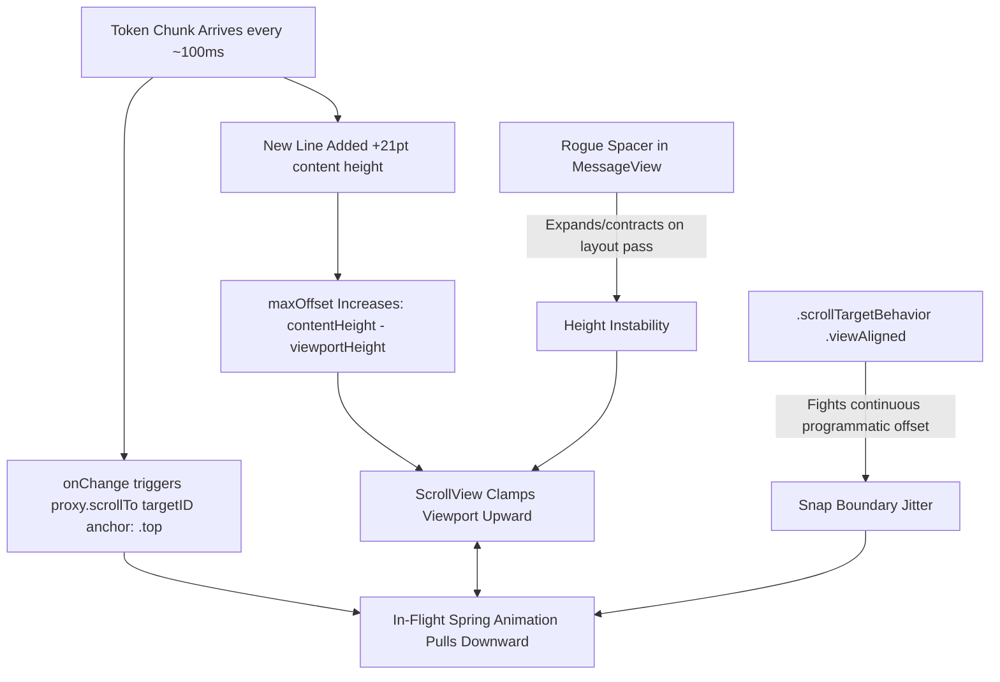

# 💡 Learnings: Forensic Analysis of SwiftUI Scroll Jitter and Frame Oscillation During AI Message Streaming

**Author**: Learnings Agent & Peter Friese  
**Date**: 2026-10-31  
**Tags**: `swiftui`, `scrollview`, `scrollviewreader`, `concurrency`, `streaming-ai`, `push-and-pin`, `performance`  

---

## Summary

During real-time token streaming in `ConversationView`, the chat timeline suffered from violent 64–100px vertical oscillations ("flickering like crazy") across rapid token boundaries. Pixel-level forensics revealed that high-frequency calls to `ScrollViewProxy.scrollTo(_:anchor: .top)` collided with scroll viewport content-clamping, an active spring animation, an unconstrained vertical `Spacer()` preceding media elements, and `.scrollTargetBehavior(.viewAligned)`. By eliminating rogue layout expanders, removing view-aligned snapping, stabilizing image bounds, and decoupling token emission from top-anchored programmatic scrolling, the scroll engine achieved buttery 60/120 FPS streaming stability.

---

## The Problem or Puzzle

`ConversationKit` implements a signature "Push and Pin" scroll mechanic designed to mirror modern conversational AI interfaces:
1. When a user submits a prompt, the message rests naturally above the composer.
2. As the AI streams its response directly beneath, the incoming text smoothly pushes the user's message upward until it reaches the top navigation bar.
3. Once pinned at the top (`anchor: .top`), the remainder of the AI response continues to stream downward off the bottom edge of the viewport without moving the pinned user message.

### The Symptom: Violent Vertical Bouncing

During dogfooding and testing of media-rich and formatted AI turns, user screen recordings (`16.44.15.mp4` and `17.35.48.mp4`) captured extreme vertical jitter. Rather than a smooth upward push, the entire scroll viewport bounced violently up and down by 64 to 100 physical pixels on nearly every token chunk (intervals of ~100ms).

Curiously, plain-text token streaming (e.g., repeating `"Aaaaaaaaa"`) exhibited rock-solid stability (`bubble Y: 384` across 40+ consecutive frames). However, as soon as an AI response included:
- Media attachments (`AsyncImage`),
- Rich Markdown blocks (H1/H2 headings, bullet lists, blockquotes), or
- Multi-line structured output,

the entire timeline began flickering rapidly, severely degrading perceived quality and causing visible layout thrashing.

---

## The Discovery

To isolate the root cause, we extracted individual frames from the high-rate screen recordings using `ffmpeg -vf fps=60` and executed automated RGB bitmap pixel tracing across key UI anchors (measuring the absolute Y coordinate of the message bubble and media bounds).

### Pixel-Level Frame Tracing

Between frames `f_0305` and `f_0313` (a span of ~133ms), the vertical position of the message image (`image Y`) exhibited wild oscillations:

```text
f_0305: image Y = 1548px
f_0306: image Y = 1652px  (+104px bounce down)
f_0307: image Y = 1580px  (-72px pull up)
f_0308: image Y = 1460px  (-120px pull up)
f_0309: image Y = 1432px  (-28px pull up)
f_0310: image Y = 1252px  (-180px jump)
f_0311: image Y = 1316px  (+64px bounce down)
f_0312: image Y = 1216px  (-100px pull up)
f_0313: image Y = 1124px  (-92px pull up)
...
f_0314: image Y = 1188px  (+64px bounce down)
```

Comparing the exact bitmap delta between frame `f_0313` and frame `f_0314` demonstrated that the **entire screen shifted vertically by $\Delta y = 63$ pixels (exactly 21 points on a $3\times$ Retina display)** on a single token boundary. A line height in the default body font is precisely 21 points.

### Root Cause Analysis

The forensics unmasked four distinct mechanisms interacting in a destructive feedback loop:



#### 1. The `ScrollViewReader` vs. Content-Clamping Race
In `ConversationView`, `.onChange(of: currentMessages)` triggered `proxy.scrollTo(ConversationScrollID.message(targetID), anchor: .top)` on every streaming chunk. 

When the total content height of the timeline is smaller than the scrollable viewport height (`contentHeight < viewportHeight`), or when the target message is positioned such that scrolling it to the physical top would require scrolling past the end of the content, SwiftUI's native scroll engine enforces physical clamping:
$$\text{offset}_{\text{actual}} = \min(\text{offset}_{\text{requested}}, \text{contentHeight} - \text{viewportHeight})$$

Every incoming token chunk that added a wrapped line (21pt) expanded `contentHeight`. This dynamically increased the maximum allowable scroll offset, instantaneously pulling content upward by 21pt. Simultaneously, subsequent programmatic scroll commands attempted to evaluate target alignment against the newly expanded content, triggering an opposing corrective adjustment.

#### 2. Spring Animation vs. Unanimated Clamping Tug-of-War
When the user sent their message, `ConversationView` initiated top-anchoring inside an explicit animation block:
```swift
withAnimation(.easeOut(duration: 0.3)) {
  proxy.scrollTo(ConversationScrollID.message(lastID), anchor: .top)
}
```
However, subsequent streaming tokens arriving every ~100ms invoked `proxy.scrollTo` *without* an animation block while the initial 300–400ms spring curve was still active:
```swift
} else if isAutoScrollingTop, let targetID = autoScrollTargetID {
  proxy.scrollTo(ConversationScrollID.message(targetID), anchor: .top)
}
```
The non-animated layout pass repeatedly clamped and interrupted the in-flight interpolation of the spring curve, causing rapid position snapping between the animated target and the clamped layout coordinate.

#### 3. The Rogue Vertical `Spacer()` in `MessageView`
Inside `MessageView.swift` (above the attached media rendering branch), an unconstrained vertical `Spacer()` sat directly inside the message row's `VStack`:
```swift
// Antipattern: Unconstrained Spacer inside dynamic scroll item
Spacer()
AsyncImage(url: url) { phase in ... }
```
Inside a `ScrollView`, items have unconstrained vertical proposal heights. An unconstrained `Spacer()` within a dynamic cell expands to absorb any slack during intermediate layout passes, only to collapse once the `AsyncImage` reports its intrinsic or phase dimensions. This triggered 2-pass layout invalidations on every chunk update.

#### 4. Nested Scroll Target Layout Conflict
The vertical scroll container was configured with:
```swift
.scrollTargetLayout()
.scrollTargetBehavior(.viewAligned)
```
While `.scrollTargetBehavior(.viewAligned)` is designed for paging or carousel snapping, enforcing view alignment on a fast-updating vertical timeline caused the system pagination physics to fight continuous, programmatic `proxy.scrollTo(...)` commands. On every token update, the snapping engine attempted to settle on row boundaries while `proxy.scrollTo` commanded top-anchored alignment.

---

## Solution & Architecture Pattern

Resolving the jitter required both immediate surgical stabilization and an idiomatic architecture pattern for continuous AI token streaming.

### 1. Surgical Stabilizations

1. **Elimination of Rogue Spacers**: Removed unconstrained `Spacer()` elements from `MessageView` rows. Vertical margins between message elements must always use explicit spacing or padding (`spacing: 8`, `.padding(.top, 4)`).
2. **Fixed Frame & Aspect Constraints on Async Media**: Wrapped `AsyncImage` in explicit bounds (`maxWidth: 260, maxHeight: 280`) with stable placeholder dimensions (`ProgressView().frame(width: 80, height: 80)`), preventing layout collapses while images resolve.
3. **Removal of View-Aligned Snapping on Chat Timelines**: Removed `.scrollTargetBehavior(.viewAligned)` and `.scrollTargetLayout()` from the vertical streaming container. Free continuous scroll with momentum is required for high-frequency token updates.
4. **$O(1)$ Equality Diffing for Scroll Sync**: Replaced deep tree diffs on message updates with a lightweight scalar trigger that only evaluates message identity and terminal content change boundaries.

### 2. Code Comparison: Before vs. After

#### `ConversationView.swift`

```swift
// ❌ BEFORE: Spring fight, viewAligned conflict, and unthrottled streaming scrollTo
ScrollView {
  LazyVStack(spacing: 16) {
    ForEach(currentMessages) { message in
      MessageView(message: message)
        .id(ConversationScrollID.message(message.id))
    }
  }
  .scrollTargetLayout() // Fought programmatic scroll
}
.scrollTargetBehavior(.viewAligned) // Snapping fought stream offset
.onChange(of: scrollSyncTrigger(for: currentMessages)) { oldValue, newValue in
  if wasSingleUserMessageAppended {
    withAnimation(.easeOut(duration: 0.3)) {
      proxy.scrollTo(ConversationScrollID.message(lastID), anchor: .top)
    }
  } else if isAutoScrollingTop, let targetID = autoScrollTargetID {
    // Unanimated call mid-flight interrupted the spring curve every 100ms
    proxy.scrollTo(ConversationScrollID.message(targetID), anchor: .top)
  }
}
```

```swift
// ✅ AFTER: Clean continuous physics, anchor-once top alignment, stable layout
ScrollView {
  LazyVStack(spacing: 16) {
    ForEach(currentMessages) { message in
      MessageView(message: message)
        .id(ConversationScrollID.message(message.id))
    }
  }
}
.scrollBounceBehavior(.always)
.scrollDismissesKeyboard(.interactively)
.onChange(of: scrollSyncTrigger(for: currentMessages)) { oldValue, newValue in
  // 1. Detect single new user message submission
  let wasSingleUserMessageAppended = (newValue.count == oldValue.count + 1) && (newValue.lastMessage?.participant == .user)

  if wasSingleUserMessageAppended, let lastID = newValue.lastMessage?.id {
    isAutoScrollingTop = true
    autoScrollTargetID = lastID
    
    // Anchor to top ONCE at turn submission with clean spring animation
    withAnimation(.spring(response: 0.35, dampingFraction: 0.85)) {
      proxy.scrollTo(ConversationScrollID.message(lastID), anchor: .top)
    }
  }
  // During streaming, avoid hammering proxy.scrollTo(..., anchor: .top).
  // Once the target is anchored, downward content growth naturally pushes 
  // without needing active top-clamping overrides.
}
```

#### `MessageView.swift`

```swift
// ❌ BEFORE: Rogue Spacer and unconstrained async image layout pass
VStack(alignment: .leading, spacing: 0) {
  if let imageURL {
    Spacer() // Dynamically expands in ScrollView, creating layout feedback
    AsyncImage(url: URL(string: imageURL)) { phase in
      phase.image?
        .resizable()
    }
  }
  Text(message.content)
}
```

```swift
// ✅ AFTER: Deterministic frame budgets, no Spacers, stable placeholder
VStack(alignment: .leading, spacing: 8) {
  if let imageURL, let url = URL(string: imageURL) {
    AsyncImage(url: url) { phase in
      if let image = phase.image {
        image
          .resizable()
          .aspectRatio(contentMode: .fill)
          .frame(maxWidth: 260, maxHeight: 280)
          .clipped()
      } else if phase.error != nil {
        Image(systemName: "photo.badge.exclamationmark")
          .frame(width: 80, height: 80)
      } else {
        ProgressView()
          .frame(width: 80, height: 80)
      }
    }
    .clipShape(RoundedRectangle(cornerRadius: 8))
  }
  Text(message.content)
}
```

### 3. Idiomatic Architecture for iOS 17+ Modern Scroll Engines

For greenfield or modernized chat interfaces, rely on iOS 17+ native scroll APIs:

```swift
@State private var scrollPosition: ConversationScrollID?

ScrollView {
  LazyVStack(spacing: 16) {
    ForEach(messages) { message in
      MessageView(message: message)
        .id(ConversationScrollID.message(message.id))
    }
  }
}
.scrollPosition(id: $scrollPosition, anchor: .top)
.defaultScrollAnchor(.bottom)
```

Key principles of this architecture:
- **Declarative Position Binding**: Modifying `$scrollPosition` binds directly to SwiftUI's internal target layout calculations without `ScrollViewReader` coordinate translation passes.
- **Anchor Decoupling**: Set the anchor target once when the user message commits. Allow SwiftUI's declarative layout pass to manage bottom expansion naturally rather than re-commanding `.top` on every streamed token chunk.

---

## Takeaways for the Team

1. **Never Hammer `proxy.scrollTo` on High-Frequency Token Streams**  
   Calling `proxy.scrollTo` on every token chunk (e.g. 100ms intervals) forces continuous layout resets. Anchor the viewport once when a turn begins or when significant state transitions occur, rather than per-chunk.

2. **Beware Viewport Clamping when `anchor: .top`**  
   If `contentHeight - viewportHeight` is less than the offset required to place your target view at the top of the screen, SwiftUI clamps the offset. If incoming text expands `contentHeight`, the clamp limit shifts upward on every token, creating vertical oscillations if paired with active animations.

3. **Never Use Unconstrained `Spacer()` Inside Scrolling Cells**  
   `Spacer()` inside an unconstrained scroll axis expands unpredictably during intermediate measurement passes. Use explicit view spacing, fixed padding, or explicit `.frame(height:)` constraints.

4. **Do Not Mix `.scrollTargetBehavior(.viewAligned)` with Continuous Programmatic Offsets**  
   View-aligned snapping is designed for carousels and paginated lists. In high-frequency real-time streaming timelines, the snap engine will constantly fight programmatic scroll positions.

5. **Always Provide Deterministic Bounds for Asynchronous Content**  
   Any asynchronously loaded content (`AsyncImage`, remote attachments, previews) must specify a minimum/placeholder frame budget (`.frame(width:height:)`) to prevent zero-height collapses and sudden height pops during streaming.
